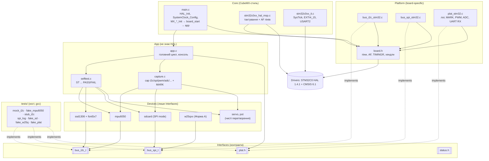

# Архітектура прошивки ЛР2

## 1. Шари і каталоги

```
firmware/
├── Core/         код у стилі STM32CubeMX: main(), MX_*_Init, MSP (тактування + AF пінів), IRQ
├── Drivers/      CMSIS 6.1 + STM32C0 HAL 1.4.1 від ST — не редагуються (docs/third_party.md)
├── Interfaces/   КОНТРАКТИ між шарами: bus_i2c.h, bus_spi.h, plat.h, status.h (лише <std*.h>)
├── Platform/     адаптація до плати: board.h (піни, хендли, параметри шин) + реалізації
│                 bus_i2c_t / bus_spi_t / plat.h над HAL (bus_*_stm32.c, plat_stm32.c)
├── Devices/      драйвери: mpu6050, ssd1306 (+font5x7), sdcard, w25qxx (Форма A), servo, pot
└── App/          прикладна логіка: self-test, консоль, сценарії запису для аналізатора
tests/            хостові тести (gcc + Unity), дублери шин, вектори з записів аналізатора
tools/            перевірки (check_deps, check_pinout), декодування VCD, генерація векторів
```

**Відмінність від орієнтовного шаблону методички** — окремий шар `Interfaces/`. У шаблоні інтерфейс
шини «живе» в Platform/, але тоді Devices/ мали б включати заголовок з Platform/, тобто шар, який
знає про HAL, і правило «драйвер залежить лише від інтерфейсу шини» стало б неперевірюваним
(будь-який заголовок Platform/ транзитивно тягне `stm32c0xx_hal.h`). Винесення контрактів в окремий
каталог без жодного HAL дає правило, яке перевіряє скрипт **і** компілятор: Devices/ і App/
збираються звичайним `gcc` у `tests/`, де заголовків HAL просто немає.

## 2. Напрямок залежностей

| Шар | Може включати | Не може |
|---|---|---|
| Interfaces | стандартна бібліотека C | усе інше |
| Devices | Interfaces, Devices | App, Platform, Core, HAL |
| App | Interfaces, Devices, App | Platform, Core, HAL |
| Platform | Interfaces, Platform, HAL/CMSIS | App, Devices |
| Core | усе (точка складання: `main()` з'єднує Platform-реалізації з App) | — |

Як це гарантовано (не «на честь»):

1. **`tools/check_deps.py`** (`make check`, частина `make build` і CI): для кожного `#include` визначає
   шар, де лежить заголовок, і звіряє з таблицею вище; додатково шукає в коді App/Devices/Interfaces
   (без коментарів і рядкових літералів) ідентифікатори `HAL_*`, `__HAL_*`, `*_HandleTypeDef`,
   `GPIOx` — щоб не можна було обійти правило ручним оголошенням. Сам скрипт покритий тестами
   (`tools/test_tools.py`): чотири види навмисних порушень мають бути спіймані.
2. **Компілятор:** `tests/Makefile` збирає Devices/ і App/ з `-I` лише на Interfaces/Devices/App —
   спроба включити HAL дає помилку компіляції хостових тестів.
3. **`tools/check_pinout.py`**: знання про плату не «розтікається» — множина пінів у `board.h`
   має збігатися з таблицею `docs/pinout.md` і з'єднаннями `diagram.json`.

## 3. Як драйвер отримує доступ до шини

Драйвер отримує **вказівник на структуру з вказівниками на функції** (`bus_i2c_t` / `bus_spi_t`,
`Interfaces/`) і непрозорий `ctx`; про `HAL_I2C_Mem_Read` він не знає:

```c
/* Interfaces/bus_i2c.h */
struct bus_i2c {
  void *ctx;
  int (*write)(void *ctx, uint8_t addr7, const uint8_t *data, size_t n);
  int (*read)(void *ctx, uint8_t addr7, uint8_t *data, size_t n);
  int (*write_read)(void *ctx, uint8_t addr7, const uint8_t *w, size_t nw, uint8_t *r, size_t nr);
  int (*probe)(void *ctx, uint8_t addr7);
};

/* Devices/mpu6050.c */
int mpu6050_identify(mpu6050_t *d) {
  uint8_t v;
  int s = i2c_reg_read(d->bus, d->addr, MPU6050_REG_WHO_AM_I, &v, 1);   /* → bus->write_read */
  ...
}
```

Контекст пристрою (`mpu6050_t`) містить вказівник на шину, адресу і стан (діапазони, останній
WHO_AM_I). Один і той самий драйвер працює:

* **на STM32** — з `board_i2c1` (`Platform/bus_i2c_stm32.c`): `write_read` → `HAL_I2C_Master_Transmit`
  + `HAL_I2C_Master_Receive` (або `HAL_I2C_Mem_Read` у режимі repeated START), коди HAL → `status_t`
  (`HAL_I2C_ERROR_AF` → `ST_ENACK`);
* **у хостовому тесті** — з `mock_i2c_bus`, `fake_mpu_bus` або `stub_i2c_bus` (`tests/doubles/`).

Для SPI `bus_spi_t` — це **пристрій** (шина + його CS#): `select()` керує саме його CS#, тож
два slave на SPI1 (SD + W25Q64 на Формі A) — це два екземпляри з різними `ctx`.

## 4. Де живе знання про плату

**Лише в `Platform/board.h`**: піни (`BOARD_<РОЛЬ>_Port/_Pin/_AF`), канали АЦП, TIMINGR I²C, прескалери
SPI, PSC/ARR таймера, extern-хендли периферії, екземпляри шин. MSP (`Core/Src/stm32c0xx_hal_msp.c`)
і `MX_*_Init` беруть номери пінів звідти ж, а не з літералів. Чому в одному місці: зміна пінa —
одна правка, яку `check_pinout.py` одразу звіряє зі схемою і таблицею; App/Devices не змінюються взагалі.

## 5. Код CubeMX і повторна генерація

`Core/` має структуру проєкту CubeMX (Makefile-тулчейн), власний код — **лише між
`/* USER CODE BEGIN x */ … /* USER CODE END x */`**: у `main.c` це виклики `board_start()`,
`app_init()`, `selftest_run()`, `app_poll()`; у `main.h` — `#include "board.h"`.
Обмеження секцій USER CODE, які враховано:

* CubeMX зберігає лише вміст секцій; усе поза ними (зокрема наші `MX_*_Init`, що повертають
  `HAL_StatusTypeDef` для звіту `[init] ... HAL_OK`) буде перезаписано стандартними `void MX_*_Init`
  з `Error_Handler()`. Тому вся логіка ініціалізації, яку шкода втратити, винесена у `board_start()`
  (Platform/), а `MX_*_Init` містять лише те, що CubeMX і так згенерує з `.ioc`.
* Секції не можна додавати довільно — лише існуючі мітки; нові файли (Platform/, Devices/, App/)
  CubeMX не чіпає, тож вони і є «безпечним місцем» для коду.
* MSP CubeMX генерує з літеральними `GPIO_PIN_x` — після регенерації треба повернути макроси
  `BOARD_*` (або генерувати з User Label у `.ioc`, тоді CubeMX сам створить `#define` у `main.h`).
  `.ioc` у репозиторії поки немає (проєкт у ЛР1 створено вручну) — `check_pinout.py` компенсує це,
  звіряючи `board.h` зі схемою.

## 6. Component diagram



Стрілка — «включає / викликає»; пунктир — «реалізує контракт». Жодна стрілка не йде з App/Devices
у Platform/HAL — це й перевіряє `check_deps.py`.

## 7. Тестування: test doubles

| Дублер | Вид | Що робить | Де потрібен саме він |
|---|---|---|---|
| `stub_i2c` | **stub** | на будь-який виклик повертає заданий код (NACK, TIMEOUT); нічого не перевіряє | обробка помилок: «драйвер повертає ST_ENACK з кожної функції і не псує стан» |
| `mock_i2c` | **mock** | тест задає *очікувану послідовність* транзакцій (адреса, байти, відповідь); будь-яке відхилення порядку чи байтів — провал | `test_init_wakes_chip_first_then_configures`: важливо не лише «init повернув OK», а що **першим** записано `PWR_MGMT_1 = 0x01` — інакше справжній чип ігнорує конфігурацію. Fake тут недостатньо: він прийняв би записи в будь-якому порядку |
| `fake_mpu6050` | **fake** | спрощена робоча модель: регістровий файл, автоінкремент, SLEEP після POR (дані = 0, поки чип спить) | інтеграція драйвер + App: self-test, `imuchk`, нахили — без опису кожної транзакції |
| `spi_log` | журнал (основа mock-перевірок для SPI) | записує CS↓/CS↑/байти MOSI-MISO/частоту | перевірка кадрування: команда + адреса + дані під одним CS#; 80 тактів при CS# = 1 |
| `fake_sd`, `fake_w25q` | **fake** | байтові моделі карти (CRC7 для CMD0/8, idle → ready через ACMD41, токени) і NOR-flash (WEL, BUSY, запис без WEL ігнорується) | `fake_w25q` + `spi_log` разом: «PP після WREN» перевіряється і послідовністю (mock-підхід), і ефектом (без WEL дані не змінились) |
| `fake_plat` | **fake** | лог у буфер, віртуальний час, змінні для серво/АЦП/кнопки | тести App/ і розбору формату self-test |

Свідомо **не покриваються** хостовими тестами: `Core/` і `Platform/` (тонкі обгортки над HAL;
перевіряються на цілі — self-test у Wokwi, сценарії `tests/sim/*.yaml` і записи аналізатора),
а також сам HAL (вендорський код).
