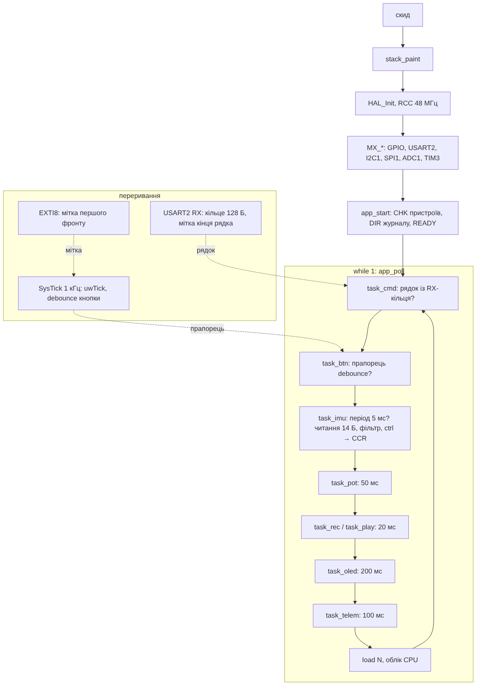
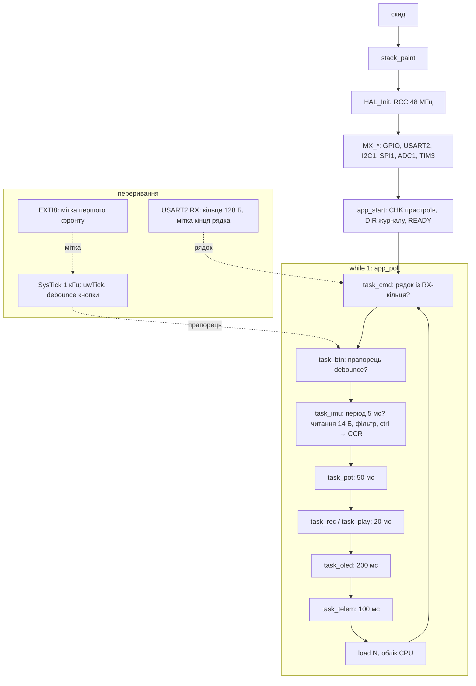
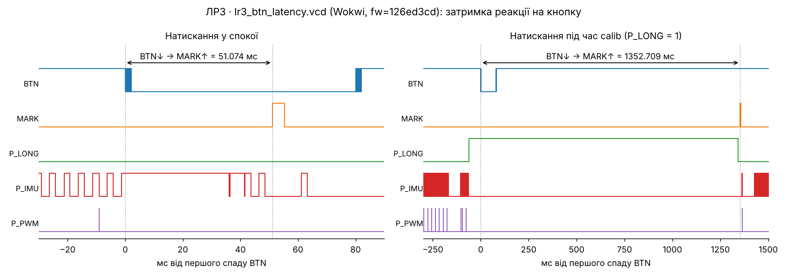

# Звіт з лабораторної роботи №3

**Bare-metal прошивка продукту (super loop): реалізація, вимірювання, межі підходу**

Курс «Системне програмування вбудованих систем» · Проєкт: **Motion-Mirroring Teleoperator** (`docs/PRD.md`)
Форма виконання: **B (Wokwi)** · Плата: **NUCLEO-C031C6** (STM32C031C6T6, Cortex-M0+, 48 МГц, 32 КБ Flash, 12 КБ RAM)
Здача: pull request `lab3 → main`, тег `lab3` на фінальному коміті.

Виконавець: **Панюшкін Владислав Вадимович**, група ІО-34 (індивідуальне виконання — усі п'ять ролей, розд. 9).

> Усі часові числа отримано в симуляторі Wokwi, на одній збірці прошивки (`fw=126ed3cd` у банері кожного
> логу), прогоном `tools/run_lab3.sh` (13 сценаріїв). Логи — `docs/metrics/*.log`, зведення —
> `docs/metrics/results.md`. Які числа достовірні, а які ні — §4.7. Попередні прогони, у яких
> виявлено дефекти, збережено в `docs/metrics/run1/` і `run2/` (журнал проблем, §7).

## Зміст

1. Підсумок результатів
2. Статус функціональних вимог
3. Опис прошивки
4. Вимірювання
5. Використання пам'яті
6. Реєстр обмежень (зведення)
7. Журнал проблем
8. Висновок: чи потрібна продукту ОС
9. Внесок учасників
10. Відеозвіт
11. Відповіді на контрольні питання

---

## 1. Підсумок результатів

| Вимога методички | Результат | Де |
|---|---|---|
| 1. FR PRD в одній прошивці, статус кожної з доказом | ✅ 12 FR в одній збірці; 7 виконано, 5 — з обмеженням, недосяжних немає (§2) | `firmware/`, `docs/tasks.md` |
| 2. Швидкодія: час задач, період циклу, затримка реакції, джитер, CPU у кількох сценаріях | ✅ вимірювальний модуль `perf.c` (min/avg/max, гістограма, p99, пропущені, CPU по вікнах 1 с), EVT-мітки, 4 службові піни; S1–S3 + 8 сценаріїв 6.2 + FR-02, FR-12 | `firmware/App/perf.c`, `docs/metrics/` |
| 3. Пам'ять: Flash/RAM за модулями, стек (статично і виміряно), heap, запас | ✅ Flash 73.2 %, RAM 35 %, стек 724 Б виміряно / ≈ 770 Б оцінка, heap 0 (§5) | `firmware/Makefile` (`-fstack-usage`, `--print-memory-usage`) |
| 4. Сценарії розділу 6, порівняння між собою і з PRD | ✅ 13 автоматизованих сценаріїв Wokwi з однаковим зерном випадковості | `tests/sim/lr3_*.yaml`, `tools/lr3_gen_scenarios.py` |
| 5. Реєстр обмежень ≥ 5, з доказами | ✅ 8 обмежень у 7 категоріях + «що super loop робить краще» | `docs/limitations.md` |
| 6. Базова лінія для ЛР4 | ✅ сценарії, метрики, 11 гіпотез, інструментарій | `docs/baseline-lab4.md` |
| Хостові тести з ЛР2 працюють | ✅ **105 тестів** (11 наборів), усі проходять; нові: `test_motion`, `test_traj`, `test_perf`, `test_fmt` і 17 тестів продукту в `test_app` | `make test` |
| Журнал проблем ≥ 5 | ✅ 9 записів (П-13 … П-21, П-21 — відкрита) | §7 |

## 2. Статус функціональних вимог

Вердикт — за максимумом у найгіршому сценарії, де вимога діє (методичка §6.3).

| FR | Вимога PRD | Виміряно (сценарій) | Статус | Обмеження |
|---|---|---|---|---|
| FR-01 | IMU 200 Гц ±2 % | S1: 1353 відліки за 10.27 с ≈ **132 Гц**, 50 пропусків; з `oled 2`: 796 за 4 с = **199 Гц**, 0 пропусків (6.2.5) | **з обмеженням** — виконується лише з покроковим оновленням OLED | Обм. 1, 2 |
| FR-02 | pitch/roll ≤ 3° у статиці | 0° → 0.00°; 30° → 29.64°; 45° → 44.91°; −30° → −29.44° (`fr02_static`) — похибка ≤ 0.56° | виконана | — |
| FR-03 | IMU → PWM ≤ 50 мс | у проході: max 2.30 мс (S2), 5.27 мс (S3); але під час `dump`/`calib` серво не оновлюються до 0.6–1.4 с | **з обмеженням** (S3) | Обм. 2 |
| FR-04 | dead-zone 0–10° з потенціометра | хостовий тест `test_deadzone_from_pot_fr04` (0 % — рухається, 100 % — ні); у Wokwi потенціометр у 0 (`dz_cd=0`) | виконана | — |
| FR-05 | серво 0–180° (500–2500 мкс) | `angle 12000 -12000` (±120°) → 2500 і 500 мкс (`test_angle_override_clamped_fr05`); 45° → 1999 мкс (`fr02_static`) | виконана | — |
| FR-06 | Live → Record → Playback кнопкою, debounce 50 мс | 40/40 натискань → 40 перемикань у правильному порядку (6.2.2), 30/30 (S3); реакція до 933.5 мс під час довгої операції | виконана (числової вимоги до реакції в PRD немає) | Обм. 2 |
| FR-07 | запис ≥ 50 Гц, ≥ 60 с, без пропусків > 25 мс | 105 с: 5267 записів (50.2 Гц), але **528 інтервалів > 25 мс, max 140 мс** (6.2.6) | **з обмеженням** | Обм. 1 |
| FR-08 | темп відтворення ±2 % | 12 021 / 12 020 мс (+0.01 %, `boot_power`); 20 304 / 20 240 мс (+0.3 %, S2) | виконана | — |
| FR-09 | траєкторія зберігається після вимкнення | після `reset` журнал цілий (CRC блоків, `PLAY done records=601`); запис, перерваний скидом, втрачається | **з обмеженням** | Обм. 7 |
| FR-10 | OLED режим і кути ≥ 5 Гц | 4.9 кадр/с (S1–S3), 4.7 з `oled 2` — період 200 мс від початку кадру плюс зсув циклу | **з обмеженням** (на межі; лікується періодом 190 мс) | Обм. 1 |
| FR-11 | телеметрія 115200 8N1, `mode`/`calib`/`status` | усі команди відповідають (`test_telemetry_and_commands_fr11`, усі сценарії); під потоком команд губиться 469 із 1105 байтів (6.2.3) | виконана (з обмеженням під потоком) | Обм. 3 |
| FR-12 | перевірка MPU-6050 і SD на старті | без MPU-6050: `CHK imu=NACK`, `ERR IMU not found: servo centered`, серво 1500 мкс, цикл працює (`fr12_noimu`) | виконана | — |

## 3. Опис прошивки

### 3.1 Шари і що змінилося після ЛР2

Структура шарів ЛР2 (`App → Devices → Interfaces ← Platform`, перевіряється `tools/check_deps.py`)
збережена. Нове:

- `App/app.c` — продукт: режими, задачі, команди, статистика (замість демо-команд ЛР2);
- `App/motion.c` — комплементарний фільтр у фіксованій точці (α = 0.98, наближений `atan2` ≤ 0.25°),
  dead-zone, обмеження кута і швидкості (360 °/с);
- `App/traj.c` — формат журналу на SD: каталог у LBA 2048, блоки 512 Б з 16-байтним заголовком,
  Δ-кодування пар кутів (0.1°), 249 записів у блоці, CRC-16/CCITT;
- `App/perf.c` — статистика часу, гістограма джитера, завантаження CPU;
- `Platform/fmt.c` — власний `printf`-подібний форматер (≈ 0.4 КБ замість ≈ 5 КБ newlib);
- драйвери I²C, SPI, UART, ADC, TIM на регістрах замість HAL (П-13);
- **часова база**: на Cortex-M0+ немає DWT, тому лічильник тактів складено з `uwTick × 48000 +
  (LOAD − VAL)` SysTick з перевіркою `PENDSTSET` (`plat_cycles()`, роздільна здатність 1 такт = 20.8 нс,
  переповнення раз на 89.5 с).

### 3.2 Головний цикл, задачі, переривання

Повний перелік задач з періодами, дедлайнами і виміряним часом — **`docs/tasks.md`**.



Те саме у вигляді Mermaid (рендериться на GitHub):



Задачі — функції без стану виконання між викликами: кожна перевіряє власну мітку часу і виходить,
якщо її час не настав. Довгі операції (`dump`, `calib`) — звичайні блокувальні функції в `task_cmd`.

**IMU-планування.** `imu_next += period`; якщо цикл відстав більше ніж на період — ресинхронізація
`imu_next = now + period` (не наздоганяти пачкою: це дало б кілька відліків поспіль без нових даних).
Звідси «від'ємний» мінімум джитера (до −2.8 мс): після ресинхронізації наступний запуск може
відбутися раніше номінальної сітки.

### 3.3 Найгірша затримка реакції

Для події, обробник якої — задача X у циклі:

```
L_max(X) = t_виявлення + Σ_{i ≠ X} C_i,max + C_X,max
```

де `t_виявлення` — час, поки апаратна подія стане видимою циклу (для кнопки — debounce 50 мс у SysTick),
`C_i,max` — найдовше тіло кожної іншої задачі (бо подія може настати одразу після перевірки X).
Для кнопки: 50 мс + `oled` 63 мс + `imu` 2.4 мс + `telem` 3 мс + `cmd` (до 1.4 с при `dump`/`calib`) — тобто
**≈ 120 мс без довгих операцій і ≈ 1.5 с з ними**. Аналізатор: 117.65 мс у спокої (натискання збіглося з кадром OLED) і 1352.7 мс під час `calib`. Виміряно: 138.2 мс (S3, з `dump` рідше) і
933.5 мс (6.2.2) — у межах оцінки.

## 4. Вимірювання

### 4.1 Методика

| Що | Як | Вартість виміру |
|---|---|---|
| час задачі | `t0 = plat_cycles()` на вході, `perf_add_us()` на виході: n/min/avg/max | ≈ 1.5 мкс на задачу (2 читання SysTick + додавання) |
| період/джитер IMU | різниця моментів запуску відносно номінального періоду, гістограма 12 кошиків (50 мкс … 100 мс), p99, `missed` (> 2 періодів) | у тілі `imu` |
| затримка кнопки | `btn_edge`: мітка першого спаду в EXTI → початок `task_btn`; `btn_db`: підтвердження debounce (SysTick) → початок `task_btn`; пін MARK | — |
| затримка команди | мітка символу кінця рядка в RX-перериванні → початок обробки | — |
| IMU → PWM | кінець читання IMU → запис CCR (`LAT imu2pwm`) | — |
| CPU | частка часу задач, що виконали роботу, у вікні 1 с (`LOAD`) | — |
| стек | stack painting шаблоном `0xDEADBEEF` від `_estack − _Min_Stack_Size`, команда `stats` | — |
| незалежний метод | логічний аналізатор Wokwi: P_IMU (PA9), P_PWM (PA10), P_LONG (PA15), MARK (PB3), BTN (PA8) → `.vcd` → `tools/lr3_vcd.py` | GPIO-запис ≈ 0.1 мкс |

Вимірювальний код увімкнено постійно — його вартість входить у числа: прохід циклу без жодної
роботи займає 58 мкс (14 перевірок часу з читанням SysTick).

Кожен сценарій починається з `stats reset` і закінчується `note <тег>; stats` — `tools/lr3_metrics.py`
розбиває лог за тегами. Кількість: періодичні задачі — тисячі запусків (S1: 1353 відліки IMU,
6.2.6: 14 349), події — 30 (S3) і 40 (6.2.2) натискань.

### 4.2 S1 / S2 / S3

| Метрика | S1 | S2 (REC) | S3 | Вимога PRD | Спосіб | Вердикт |
|---|---|---|---|---|---|---|
| `imu`, avg / max | 2.02 / 2.17 мс | 2.23 / 2.37 мс | 2.20 / 38.1 мс | — | такти | — |
| IMU-інтервал, max | 66.2 мс | 78.0 мс | 604 мс | 5 мс ±2 % | такти + VCD | не виконана |
| IMU пропущено | 50 / 10 с | 109 / 20 с | 233 / 27 с | 0 | такти | не виконана |
| IMU → PWM, max | — | 2.30 мс | 5.27 мс | ≤ 50 мс | такти | виконана в проході |
| кнопка: фронт → реакція, max | — | 68.0 мс | 138.2 мс | debounce 50 мс | EXTI + такти, VCD | — |
| команда → обробка, max | 63.2 мс | 1.59 мс | 105.8 мс | — | RX-ISR + такти | — |
| `oled`, max | 62.9 мс | 63.0 мс | 64.5 мс | — | такти | — |
| OLED, кадрів/с | 4.9 | 5.0 | 4.8 | ≥ 5 | лічильник | на межі |
| прохід циклу, avg / max | 0.20 / 65.8 мс | 0.23 / 80.1 мс | 0.38 / 676 мс | — | такти | — |
| CPU, max | 61 % | 66 % | 91 % | — | вікна 1 с | — |
| запис: інтервали > 25 мс | — | 103 (max 82 мс) | 4 (max 96 мс) | 0 | лічильник | не виконана |
| стек | 724 Б | 724 Б | 724 Б | 1024 Б | painting | запас 300 Б |

**S3 − S1.** IMU-джитер: 66 → 604 мс (×9), CPU: 61 → 91 %, затримка команди: 63 → 106 мс, кнопка: 68 → 138 мс (S2 → S3).
Навантаження S3 (довга операція `dump`) коштує ≈ 540 мс джитера IMU — обмеження 2.

### 4.3 Сценарії 6.2

| # | Сценарій | Результат | Висновок |
|---|---|---|---|
| 6.2.1 | довга операція і періодична задача (`longop`) | IMU-джитер max **1409.7 мс** (S1: 66 мс), p99 у кошику > 100 мс; `dump` 1.03–1.40 с | періодична задача стоїть увесь час операції |
| 6.2.2 | 40 натискань під час `dump` (`event_longop`) | усі 40 оброблено; фронт → реакція: min 50.4 мс, avg 92.5 мс, **max 933.5 мс** | жодне натискання не загублено (прапорець у SysTick), але реакція відкладається на всю операцію |
| 6.2.3 | потік команд (`uart_flood`) | у спокої відкинуто 10 / 210 Б; під час `dump` **469 / 1105 Б**, ORE 0; команда чекає до 375 мс | втрати — у програмному кільці (128 Б), не апаратні |
| 6.2.4 | «SDA затиснута» 2 с (`fault`) | 47 тайм-аутів по 20 мс + 2 мс скиду; цикл max 993 мс; OLED-кадр 968 мс; IMU відновлюється сам | блокування пропорційне кількості транзакцій задачі |
| 6.2.5 | точка зламу (`breakpoint`) | частота IMU: норма до 400 Гц, 600 Гц — 44 пропуски, ≥ 1000 Гц — кожен період; OLED: режим 2 → 0 пропусків, джитер 3.3 мс; `load 1000 мкс` → CPU 96 % | «стеля» — 2 мс на відлік по I²C 100 кГц |
| 6.2.6 | 105 с у S2 (`long_run`) | переповнення лічильника тактів на 89.5 с без наслідків (`imu_err=0`, `LAT imu2pwm` max 2.29 мс, missed стабільно ≈ 5.2/с); стек 724 Б не росте, heap 0; 5267 записів | довготривалих дефектів немає; 1 год неможлива на безкоштовному Wokwi CI (§4.7) |
| 6.2.7 | старт | `CHK` всіх пристроїв, перший відлік IMU через **208.8 мс** після скиду (200 мс — пауза після скиду MPU-6050 за datasheet) | — |
| 6.2.8 | «зникнення живлення» під час запису (`boot_power`) | цілий журнал після скиду: `DIR OK blocks=3 records=601`, CRC усіх блоків, темп 12 021 / 12 020 мс; запис, перерваний скидом, — втрачено | каталог пишеться лише на `rec stop` (обм. 7) |

### 4.4 Анотований запис аналізатора: затримка реакції на кнопку

Файл `docs/captures/lr3_btn_latency.vcd` (сценарій `vcd_btn`), розбір — `docs/metrics/vcd_btn.md`
(`tools/lr3_vcd.py`). Канали: D0 BTN (PA8), D1 P_IMU, D2 P_PWM, D3 P_LONG, D4 PWM_PAN, D6 MARK.

| # | Момент, мс | BTN↓ → MARK↑ (аналізатор) | `lat_edge_us` (прошивка, EVT) | Різниця | Під час `calib` (P_LONG = 1) |
|---:|---:|---:|---:|---:|---|
| 1 | 3 939.5 | 51.074 мс | 51.065 мс | 9 мкс | ні |
| 2 | 4 551.5 | 117.650 мс | 117.642 мс | 8 мкс | ні (збіг із кадром OLED і записом каталогу REC → PLAY) |
| 3 | 5 297.5 | 52.462 мс | 52.452 мс | 10 мкс | ні |
| 4 | 6 737.5 | 1 052.664 мс | 1 052.675 мс | −11 мкс | так |
| 5 | 8 714.5 | 1 017.631 мс | 1 017.642 мс | −11 мкс | так |
| 6 | 10 355.5 | 1 352.709 мс | 1 352.727 мс | −18 мкс | так |

У спокої: 51–118 мс (медіана 52.5 мс = debounce 50 мс + решта проходу). Під час `calib` (1.40 с):
1.02–1.35 с — реакція чекає кінця операції. Ці три натискання й демонструють обмеження 2.

Як читати запис у PulseView (`File → Import → VCD`):

1. **BTN** падає з 1 в 0 і ≈ 1 мс брязкотить (Wokwi моделює брязкіт кнопки) — це «перший фронт».
2. Через 50 мс стабільного рівня SysTick підтверджує натискання; **MARK** піднімається на початку
   `task_btn`, тобто в наступному проході циклу. У спокої відстань BTN↓ → MARK↑ = 50 мс + не більше
   одного кадру OLED.
3. Під час `calib` **P_LONG** = 1 ≈ 1 с: натискання відбулося всередині, MARK піднімається лише після
   спаду P_LONG — затримка дорівнює залишку довгої операції.
4. **P_IMU** — імпульси шириною ≈ 2.1 мс з періодом 5 мс; на час P_LONG і кадрів OLED імпульси
   зникають («дірки» в періодичному сигналі, методичка §5.3). Ліворуч P_IMU тримається 37 мс:
   брязкіт кнопки зірвав транзакцію I²C, і відлік чекав тайм-аут (П-21).



### 4.5 Порівняння двох способів вимірювання

| Метрика | Такти SysTick (прошивка) | Логічний аналізатор (VCD) | Різниця і пояснення |
|---|---|---|---|
| час `task_imu` | avg 2.02 мс, max 2.17 мс (S1) | ширина P_IMU: медіана 2.094 мс, max 38.3 мс (відлік з повтором після тайм-ауту I²C) | пін піднімається до `t0` і опускається після запису CCR — у ширину входять фільтр і `ctrl` (≈ 0.1 мс) |
| інтервал IMU | max 66.2 мс (S1) | max 1.47 с (під час `calib`) | різні вікна (у VCD-сценарії є `calib` і запис) |
| кнопка: фронт → реакція (6 натискань) | 51.065 / 117.642 / 52.452 / 1052.675 / 1017.642 / 1352.727 мс (`lat_edge_us`) | 51.074 / 117.650 / 52.462 / 1052.664 / 1017.631 / 1352.709 мс (BTN↓ → MARK↑) | ≤ 18 мкс (< 0.04 %): прошивка ставить мітку у вході EXTI (+≈ 1 мкс до фронту) і реакцію — до `plat_mark(true)`; знак різниці змінюється, коли між мітками є вкладене SysTick-переривання |

Порівняння й виявило П-19: до виправлення прошивка показувала для натискань під час довгих операцій
5.8 мс і навіть «89 с» (від'ємне значення в `uint32_t`). Після виправлення два методи збігаються в межах 18 мкс.

### 4.6 Порівняння з розрахунком

| Операція | Розрахунок | Виміряно | Розбіжність |
|---|---|---|---|
| читання MPU-6050 (адреса+регістр, повторний старт, адреса+14 Б ≈ 17 байтів × 9 біт) на 100 кГц | 1.53 мс | `i2c_burst` 1.62 мс | +6 %: START/STOP, пауза 300 мкс перед першим байтом лише для запису (не тут) |
| кадр OLED (5 рядків × 126 Б + 20 транзакцій × 2 Б + вікна ≈ 700 Б) | 700 × 9 / 100 кГц = 63.0 мс | `oled` 62.8 мс | −0.3 % |
| рядок телеметрії ≈ 30 Б на 115200 8N1 | 30 × 10 / 115200 = 2.60 мс | `uart_line` 2.59 мс | < 1 %: TX блокувальний |
| відповідь `status` ≈ 100 Б | 8.7 мс | `cmd` avg 8.74 мс (потік) | < 1 % |
| запис блоку SD 512 Б на SPI 6 МГц | 512 × 8 / 6 МГц = 0.68 мс | `sd_write` 3.99 мс | ×5.9: побайтний цикл опитування TXE/RXNE (≈ 4 мкс/байт), команди і очікування готовності карти в Wokwi |
| `dump` 30 с журналу (7 блоків × 16 рядків × 74 Б) | 8288 × 10 / 115200 = 0.72 с + 7 × 3.8 мс читання = 0.75 с | 1.03 с | +37 %: форматування hex на M0+ без апаратного ділення (`__divsi3` — серед найбільших символів) |

### 4.7 Достовірність чисел із симулятора

| Числа | Довіра | Чому | Як перевірити на залізі |
|---|---|---|---|
| тривалості I²C, UART, SPI-обмінів | висока | Wokwi моделює шини потактово; збіг з розрахунком ≤ 6 % | аналізатор на SCL/TX, ті самі сценарії |
| час обчислень (фільтр, `ctrl`, форматування) | середня | ядро емулюється без затримок Flash wait-state і конвеєра | DWT немає і на залізі — той самий `plat_cycles()` + GPIO |
| час SD (запис/читання блоку) | **низька** | реальна карта додає 0.1–10 мс «зайнятості» на запис, Wokwi — ні | запис 6.2.6 на реальній карті, гістограма `sd_write` |
| брязкіт кнопки | середня | Wokwi дає ≈ 1 мс; реальна кнопка — до 5–10 мс | аналізатор на BTN |
| поведінка після програмного скиду | **низька** | Wokwi не скидає АЦП (П-16) і не встановлює причину скиду (`reset=0x00`) | NRST/«живлення» на платі |
| тривалі прогони | обмежена | безкоштовний Wokwi CI обриває з'єднання через 5 хв реального часу (≈ 120 с симуляції), тому 6.2.6 — 105 с, а не 1 год | прогін 1 год на платі |
| взаємодія переривань і I²C | **низька** | тайм-аути I²C під час брязкоту кнопки (П-21) найімовірніше — наслідок відсутності clock stretching у моделі | аналізатор на SCL/SDA + BTN на платі |
| «вимкнення живлення» | обмежена | емуляція командою `reset`: SD-карта не втрачає живлення посеред запису блоку | вимкнення живлення під час `sd_write` (P_LONG = 1) |

## 5. Використання пам'яті

```
$ make build                                   (gcc-arm-none-eabi 13.2.1, -Os)
Memory region         Used Size  Region Size  %age Used
             RAM:        4296 B        12 KB     34.96%
           FLASH:       23992 B        32 KB     73.22%
$ arm-none-eabi-size build/firmware.elf
   text    data     bss     dec     hex filename
  23864     128    4176   28168    6e08 build/firmware.elf
```

У `RAM` лінкер уже враховує резерви: стек 1024 Б (`_Min_Stack_Size`) і heap 512 Б. Статичні дані
програми — 2756 Б.

| Найбільші в Flash | Б | Найбільші в RAM | Б |
|---|---|---|---|
| `app_poll` (усі задачі вбудовано) | 2056 | `app` (стан продукту + буфер блоку 512 Б + статистика) | 1236 |
| `app_handle_line` (команди) | 1364 | `sd_orig` (копія блоку для неруйнівного self-test ЛР2) | 512 |
| `main` + `MX_*` | 716 | `__sf` + `_impure_data` (newlib, тягне `strtol`) | 388 |
| `HAL_RCC_OscConfig` | 620 | `buf.1` (рядок `plat_log`) | 160 |
| `app_start` | 588 | `rx_ring` | 128 |
| `app_stats` | 476 | `buf.0` (рядок OLED) | 126 |
| `__divsi3` (ділення на M0+) | 460 | | |

**Стек.** Статична оцінка (`-fstack-usage`, `firmware/build/*.su`): найглибший ланцюжок
`main` 80 → `app_poll` 136 → `app_handle_line` 184 → `selftest_imu` 176 → `imu_measure` 96 →
драйвер ≈ 32 + `plat_vfmt` 72 → вкладене переривання ≈ 32 ⇒ **≈ 770 Б**. Виміряно (stack painting,
усі сценарії): **724 Б** із 1024 Б. Оцінка більша, бо підсумовує найгірші гілки, які в реальності не
збігаються (self-test не викликається одночасно з форматуванням великих рядків). Запас — 300 Б (29 %).
`-Wstack-usage=256` не дає попереджень: жодна функція не має кадру > 256 Б.

**Heap** не використовується (`malloc` не викликається, `MEM heap=0`); резерв 512 Б можна
віддати стеку.

**Як змінилося після ЛР2** — П-13: з HAL I²C/SPI/ADC/TIM/UART і `printf` прошивка ЛР3 займала б
> 31 КБ; після переходу на регістри — 23.4 КБ при більшій функціональності.

## 6. Реєстр обмежень (зведення)

Повністю, з доказами, обходами без ОС, вартістю ОС і гіпотезами — **`docs/limitations.md`**.

| # | Обмеження | Доказ (коротко) | Що дасть ОС | Гіпотеза ЛР4 |
|---|---|---|---|---|
| 1 | блокувальний OLED з'їдає періоди IMU | 50 пропусків / 10 с, джитер 66 мс; з `oled 2` — 0 і 3.3 мс | витіснення + пріоритети, м'ютекс шини | missed 50 → 0 |
| 2 | довга операція зупиняє все | IMU-джитер 1.4 с, кнопка до 933.5 мс | довга операція — низькопріоритетна задача | кнопка ≤ 70 мс |
| 3 | UART губить байти під потоком | 469 / 1105 Б | задача команд + черга; пропускну здатність не змінить | dropped → 0 |
| 4 | відмова I²C блокує цикл на тайм-аути | цикл до 993 мс | очікування на семафорі з тайм-аутом | телеметрія ≤ 110 мс |
| 5 | спільний буфер SD без явного власника | П-17, П-18 | задача-власник журналу + черга запитів | `dump` у REC обслуговується |
| 6 | I²C 100 кГц — стеля частоти IMU | 400 Гц норма, 600 — пропуски | нічого суттєвого; коштує пам'ять | без змін |
| 7 | каталог журналу лише на `rec stop` | запис втрачено після скиду | часте оновлення каталогу у фоновій задачі | втрата ≤ 1 блок |
| 8 | опитувальний I²C чутливий до часу в ISR | 12 тайм-аутів, усі після натискань (П-21) | драйвер на перериваннях + семафор | 7/40 → 0 |

**Що super loop робить краще:** детермінізм (IMU → PWM 2.12–2.29 мс на 11 720 відліках), один стек
724 Б, повторюваність (S1 у трьох прогонах: ті самі 50 пропусків і 2.02/2.17 мс), старт 208.8 мс,
відсутність перемикань контексту.

## 7. Журнал проблем

Продовжує нумерацію ЛР1–ЛР2. Формат: симптом → root cause → виправлення → доказ.

**П-13. Прошивка з функціями ЛР3 не вміщується у Flash.**
Симптом: з HAL-драйверами ЛР2 і `printf` збірка після додавання фільтра, журналу і статистики
перевищувала 31 КБ із 32 КБ — немає місця ні для вимірювального коду, ні для ЛР4. Root cause: HAL
I²C/SPI/TIM/UART/ADC разом ≈ 9 КБ (універсальні шляхи DMA/IT, які продукт не використовує), newlib
`printf` ≈ 5 КБ. Виправлення: драйвери на регістрах (`Platform/bus_*_stm32.c`, `plat_stm32.c`,
`MX_*_Init` у `main.c`), власний форматер `Platform/fmt.c`; модулі HAL вимкнено в
`stm32c0xx_hal_conf.h`. Результат: 23 992 Б (73 %). Доказ: §5, `test_fmt` (2 тести), self-test ЛР2
у Wokwi проходить на нових драйверах (`tests/sim/selftest.test.yaml`).

**П-14. `att_reset()` не обнуляв зсув гіроскопа.** Симптом: хостовий тест `test_motion` — після
`calib` і `att_reset` кут дрейфував з тією ж швидкістю, що до калібрування. Root cause: функція
обнуляла кути, але не `bias_mdps[]`. Виправлення: `motion.c`. Доказ: `test_motion`.

**П-15. Ривок серво на 1.8° на першому проході.** Симптом: хостовий тест `test_deadzone_from_pot_fr04`
— на першому відліку IMU серво відхилялось, хоча кут менший за dead-zone. Root cause: dead-zone
читається з потенціометра в `task_pot` (кожні 50 мс), а перший прохід `task_imu` йде до першого
`task_pot` — з dead-zone 0. Виправлення: читання потенціометра в `app_start()` до входу в цикл.
Типова пастка super loop: порядок задач у першому проході — неявна залежність.

**П-16. Після програмного скиду АЦП не запускається (`adc=FAIL`).** Симптом: `docs/metrics/run1/boot_power.log`
— після команди `reset` банер показує `adc=FAIL`, потенціометр не працює. Root cause: Wokwi при
`NVIC_SystemReset` не скидає АЦП, і `ADEN` лишається 1; код знімав `ADEN` записом 0, що за RM0490
заборонено (лише через `ADDIS`), тож калібрування не стартувало. Виправлення: `__HAL_RCC_ADC_FORCE_RESET/
RELEASE_RESET` у `MX_ADC1_Init` і коректне вимкнення через `ADSTP`/`ADDIS` у `board_adc_calibrate`.
Доказ: `docs/metrics/boot_power.log` — `adc=OK` після кожного скиду.

**П-17. `dump` у режимі запису зіпсував би журнал.** Симптом: хостовий тест — після `dump` у REC
наступний блок на SD мав чужі дані. Root cause: один буфер `app.blk` (512 Б із 12 КБ RAM) для
кодувача запису і для читання SD у `dump`. Виправлення: `ERR dump busy: recording`. Доказ:
`test_dump_and_misc_commands`. Див. обмеження 5.

**П-18. `dump` під час відтворення губив до 249 записів.** Симптом: `docs/metrics/run2/event_longop.log`
— `REC stop records=79`, а `PLAY done records=69`; у 6.2.2 таких розбіжностей кілька. Root cause:
після `dump` буфер блоку перезаписано, і код ставив `play_n = 0`, а `task_play` розумів це як
«блок вичерпано» і переходив до наступного — решта поточного блоку пропадала. Виправлення:
перечитати поточний блок і продовжити з того ж запису (`cmd_dump`). Доказ:
`test_dump_during_play_keeps_all_records` (падає на старому коді: 55 замість 157), фінальний
`event_longop.log` — 5 відтворень, у кожному `PLAY done records` = `REC stop records` (61, 78, 79, 94, 95); у `run2` — 9 з 10 відтворень коротші (наприклад, 104 → 69).

**П-19. Вимір «перший фронт → реакція» занижувався під час довгих операцій.** Симптом:
`run2/event_longop.log` — `lat_edge_us=5847` (менше за debounce 50 мс!) і `lat_edge_us=89451973`
(«89 с»). Аналізатор для тих самих натискань показує сотні мілісекунд. Root cause: мітку першого
фронту `task_btn` читав у момент реакції. Якщо цикл був зайнятий довше за утримання кнопки (80 мс),
брязкіт відпускання (Wokwi зливає rise+fall в одне переривання EXTI) записував нову мітку — затримка
рахувалась від відпускання, а якщо воно траплялося вже після `t0` — виходило від'ємне число в `uint32_t`
(2³²/48 мкс ≈ 89.48 с). Виправлення: мітку фіксує SysTick у момент підтвердження debounce, поки
кнопка ще натиснута; EVT і статистика використовують ті самі обчислені значення. Доказ:
`test_btn_edge_latched_at_debounce`, §4.5.

**П-20. Ідентифікатор збірки в банері не оновлювався.** Симптом: прогони 1 і 2 з різними `main.c` /
`plat_stm32.c` показали той самий `fw=51601fab` — порушено вимогу «кожен результат прив'язаний до
збірки». Root cause: `FW_ID` передається як `-D` при компіляції, але використовується лише в `app.c`;
`make` перекомпільовує тільки змінені файли, і `app.o` лишався старим. Виправлення: штамп
`build/fw_id.stamp` і залежність `app.o` від нього (`firmware/Makefile`). Доказ: фінальні логи —
`fw=126ed3cd`.

**П-21 (відкрита). Натискання кнопки іноді зриває поточну I²C-транзакцію IMU.** Симптом: у
сценаріях без кнопки (S1, 6.2.6 — 105 с) тайм-аутів I²C **0**, а з кнопкою вони є: S2 — 1 на 3
натискання, S3 — 2 на 30, 6.2.2 — 7 на 40, `vcd_btn` — 2 на 6. Усі 12 подій `imu_err` настають через
10–32 мс після фронту кнопки (одна — через 112 мс, тобто після відпускання); на записі аналізатора
(рис. §4.4, ліворуч) P_IMU піднімається за 1.3 мс до натискання і тримається 37 мс замість 2 мс —
тайм-аут 20 мс + повтор. Root cause (гіпотеза, підтверджена кореляцією): брязкіт кнопки в Wokwi —
десятки фронтів за ≈ 1 мс, кожен — переривання EXTI, разом сотні мікросекунд; драйвер I²C опитує
прапорці в головному циклі, і поки ядро в перериваннях, байт на 100 кГц (90 мкс) не забирається з
RXDR. Справжній STM32 у такому разі розтягує SCL (clock stretching) і нічого не губить; Wokwi, судячи
з наслідків, — ні. Ціна: +≈ 25 мс до окремих відліків (`imu` max 38 мс у S3) і рідкісні `imu_err`
з автоматичним відновленням. Виправлення (заплановане для ЛР4, щоб не змінювати збірку базової лінії):
після першого фронту маскувати EXTI8 на 60 мс (брязкіт перестає генерувати переривання; мітка
першого фронту зберігається) і перевірити на платі з аналізатором на SCL, чи є проблема поза Wokwi.
Урок для вимірювань: **вимірювальне переривання змінило поведінку вимірюваної системи** — його
вартість треба міряти так само, як і решту.

Також (не дефекти прошивки, а інструменти — для відтворюваності ЛР4):
- `wokwi-cli` 0.29 у `--serial-log-file` склеює рядок, на якому спрацював `wait-serial`, з наступним
  (`NOTE S1STAT BEGIN…`) і обрізає останній рядок перед завершенням — розбір у `lr3_metrics.py`
  розрізає склейки, тег завершується `;`, кожен сценарій закінчується паузою 300 мс;
- `wait-serial` бачить лише новий вивід: реакція на кнопку (52 мс) настає ще під час утримання (80 мс),
  тож після натискань — паузи, а не очікування (`vcd_btn`, прогони 2–3);
- аналізатор з каналом SCL за 20 с дає 30 МБ, і Wokwi обриває запис — для `vcd_btn` SCL і TX
  від'єднано (`diagram_vcd.json`).

## 8. Висновок: чи потрібна продукту ОС

**Так, але не через швидкодію, а через змішування задач різної тривалості на одній шині.**
Виміряні числа:

1. **Найсерйозніше обмеження — блокувальні задачі поруч з жорстко періодичною.** Один кадр OLED
   (63 мс) коштує 12 періодів IMU: у номінальному режимі продукт опитує сенсор на ≈ 132 Гц замість
   200 (FR-01) і пише журнал з 528 «дірками» > 25 мс за 105 с (FR-07). Super loop може це
   виправити — режим `oled 2` дає 0 пропусків і джитер 3.3 мс, — але ціною перетворення кожної
   повільної задачі на автомат станів. Таких задач у продукті вже чотири (`oled`, `dump`, `calib`,
   запис SD), і кожна нова FR додаватиме ще.
2. **Довгі операції** роблять реакцію на кнопку непередбачуваною: від 52 мс до 933.5 мс залежно від
   моменту натискання. Витіснення розв'язує це без переписування самих операцій.
3. **Пропускну здатність ОС не збільшить**: стеля 400 Гц для IMU — це I²C 100 кГц, а втрати UART
   під потоком — співвідношення 7 Б команди до 100 Б відповіді (обмеження 3, 6).
4. **Ціна на цьому МК відчутна**: вільних 8.8 КБ Flash і ≈ 8 КБ RAM; FreeRTOS з 6–7 задачами займе
   ≈ 5–7 КБ Flash і 2–3 КБ RAM — запас зникає майже весь. Super loop зараз дає детермінізм
   IMU → PWM 2.1–2.3 мс і один стек 724 Б — ЛР4 має показати, що це не втрачено.

Гіпотези для перевірки — `docs/baseline-lab4.md` §4 (H1–H11).

## 9. Внесок учасників

Робота виконана індивідуально; усі ролі розділу 9 методички — один виконавець.

| № | Роль | Відповідальний | Внесок | Ключові артефакти |
|---|---|---|---|---|
| 1 | Розробка super loop | Панюшкін В. В. | цикл і задачі, режими, журнал SD, фільтр, команди, драйвери на регістрах | `firmware/App/app.c`, `motion.c`, `traj.c`, `Platform/*` |
| 2 | Метрики | Панюшкін В. В. | часова база без DWT, `perf.c`, EVT, службові піни, stack painting, скрипти аналізу | `firmware/App/perf.c`, `tools/lr3_metrics.py`, `tools/lr3_vcd.py` |
| 3 | Тестування | Панюшкін В. В. | 13 сценаріїв, генератор, хостові тести, таблиці, вердикти FR | `tests/sim/lr3_*.yaml`, `tools/lr3_gen_scenarios.py`, `tests/test_*.c`, `docs/metrics/` |
| 4 | Тестування на обладнанні (Форма B) | Панюшкін В. В. | прогони у Wokwi, логічний аналізатор, емуляція відмов (SDA, живлення, відсутній IMU) | `docs/captures/lr3_btn_latency.vcd`, `tools/run_lab3.sh` |
| 5 | Звіт | Панюшкін В. В. | реєстр обмежень, базова лінія, журнал проблем, звіт, відео | `docs/limitations.md`, `docs/baseline-lab4.md`, цей файл |

## 10. Відеозвіт

Тривалість 2–3 хв. Сценарій запису:

| Час | Що на екрані | Що сказати |
|---|---|---|
| 0:00–0:20 | VS Code: `docs/tasks.md`, функція `app_poll()` | «Super loop: вісім задач по черзі, кожна перевіряє свій час; три переривання лише ставлять прапорці». |
| 0:20–1:10 | Wokwi (`diagram.json`), Serial Monitor: `evt on`, `mode rec`, рух слайдера accelX MPU-6050 → серво рухаються; `dump` і натискання кнопки посеред нього | «Сценарій S3: запис, телеметрія, довга операція. Натискаю кнопку під час `dump` — режим змінюється лише після кінця виводу: `EVT name=btn lat_edge_us=…` — сотні мілісекунд». |
| 1:10–1:50 | PulseView з `docs/captures/lr3_btn_latency.vcd`: BTN, P_LONG, MARK, P_IMU; курсори BTN↓ → MARK↑ у спокої і під час P_LONG | «У спокої 52 мс — це debounce. Під час `calib` MARK чекає спаду P_LONG. На P_IMU видно дірки — IMU не опитується». |
| 1:50–2:30 | `docs/metrics/results.md` або таблиця §4.2; `stats` у Serial Monitor | «S1: 50 пропусків IMU за 10 с через OLED; з `oled 2` — нуль. Це обмеження 1 і гіпотеза для ЛР4». |
| 2:30–2:50 | `docs/limitations.md`, висновок §8 | «ОС потрібна для змішування довгих і періодичних задач; швидкість шини вона не змінить; ціна — більшість вільної пам'яті». |

## 11. Відповіді на контрольні питання

**1. Як влаштований головний цикл? Формула найгіршої затримки.** `app_poll()` по черзі викликає
8 задач (§3.2); кожна сама перевіряє свою мітку часу. Найгірша затримка події, обробник якої X:
`L = t_виявлення + Σ_{i≠X} C_i,max + C_X,max` (§3.3). Для кнопки ≈ 50 + 63 + 2.4 + 3 мс ≈ 120 мс без
довгих операцій і до ≈ 1.5 с з `dump`; виміряно 138.2 мс (S3) і 933.5 мс (6.2.2).

**2. Що таке джитер і чим він спричинений?** Відхилення фактичного моменту запуску періодичної
задачі від номінальної сітки. Виміряно двома способами: різниця тактів між запусками `task_imu` з
гістограмою (`JIT`, `HIST`) і інтервали між фронтами P_IMU на аналізаторі. Причини в прошивці: кадр
OLED 63 мс (S1, кошик 50–100 мс — рівно один інтервал на кадр), довгі операції (до 1.4 с), відмова I²C
(тайм-аути). Без них інтервали точні: у S1 1202 з 1352 (89 %) відхиляються < 100 мкс, ще 97 — на 1–5 мс (перший запуск після ресинхронізації), 50 — у кошику 50–100 мс (кадри OLED).

**3. Чому важливий найгірший час? Чи справжній максимум?** Дедлайн порушує один найгірший випадок,
а не середній: середній прохід циклу 0.2 мс нічого не каже про 66 мс, коли серво не оновлюються.
Справжність максимуму: тисячі запусків (S1: 1353; 6.2.6: 14 349), випадкові моменти подій
(40 натискань, зерно `SEED=3`), повторюваність між прогонами (S1 у трьох прогонах — той самий max
2.17 мс), збіг з аналізатором і з розрахунком через формулу §3.3.

**4. Лічильник DWT; різниця беззнакових після переповнення.** DWT->CYCCNT — 32-бітний лічильник
тактів ядра; на Cortex-M0+ його немає, тому `plat_cycles()` складено з SysTick (§3.1) з тією ж
властивістю: значення за модулем 2³². Різниця `b − a` у `uint32_t` дає правильний результат за
модулем 2³², тобто коректна, доки справжній інтервал < 2³² тактів = **89.48 с** при 48 МГц. Після
цього інтервал «загортається». Коли стає некоректною на практиці — П-19: від'ємний інтервал (мітка
пізніше за `t0`) перетворюється на ≈ 89.4 с. 6.2.6 перевіряє перехід через 89.5 с.

**5. Чому не можна мірити затримки за часом прибуття рядка на хості?** Рядок проходить через
блокувальний вивід UART (2.6–8.7 мс на рядок), USB-міст і буферизацію ОС хоста / `wokwi-cli`;
ця затримка змінна і може бути більшою за вимірюване. Тому всі мітки беруться в прошивці
(`t_us=` у EVT, `LAT …`) і на аналізаторі.

**6. Що можна в ISR? HAL з тайм-аутом в ISR.** Можна: коротко прочитати/скинути прапорці, покласти
байт у кільце, зробити мітку часу, встановити прапорець (як у `board_uart_rx_irq`, `board_btn_exti`,
`app_tick_1ms`). Не можна: чекати пристрої, друкувати, викликати драйвери шин. HAL-функція з
тайм-аутом рахує його через `HAL_GetTick()`, а `uwTick` збільшується в SysTick; якщо ISR має
пріоритет, вищий або рівний SysTick, тік не збільшується — тайм-аут ніколи не настає і програма
зависає. Навіть якщо настає — усі інші переривання того ж пріоритету стоять увесь тайм-аут.

**7. `volatile` — що гарантує і чого ні.** Гарантує, що кожне читання/запис реально звертається до
пам'яті і не викидається оптимізатором. Не гарантує атомарності і порядку між кількома змінними.
Приклад із коду: `btn_pending` (`volatile`) збільшує SysTick, а `task_btn` робить
`if (!btn_pending) return; … btn_pending = 0;` — якщо друге натискання підтвердиться між перевіркою і
обнуленням, воно загубиться. Для двох натискань за 50 мс це неможливо фізично, але правильно —
`__disable_irq()` навколо читання-обнулення (на M0+ немає LDREX/STREX). Так само `tick_pair()`
читає пару `uwTick`/`SysTick->VAL` у циклі до збігу, бо дві `volatile`-змінні не читаються атомарно.

**8. text, data, bss; чому не видно стека.** `text` — код і константи у Flash; `data` — ініціалізовані
змінні (займають і Flash, звідки копіюються, і RAM); `bss` — нульові змінні в RAM. Стек і heap —
лише зарезервовані лінкером області без вмісту (тут вони входять у `bss`-підсумок `--print-memory-usage`
як резерв 1024 + 512 Б); скільки стека реально використано, `size` знати не може — це властивість
виконання, а не образу.

**9. Статична і виміряна оцінка стека.** Статична (`-fstack-usage`) — сума кадрів найглибшого
можливого ланцюжка (≈ 770 Б); виміряна (painting) — найглибше місце, яке реально зачепили виконані
сценарії (724 Б). Статична більша, бо додає найгірші гілки, які не трапляються одночасно; але вона
не бачить непрямих викликів і вкладених переривань, тому обидві потрібні.

**10. RAM і роздільна здатність кадру камери.** У нашому продукті камери немає (PRD), але аналог —
буфер блоку SD і екран: 12 КБ RAM не вміщують навіть буфер кадру SSD1306 (1 КБ) поруч з усім
іншим без втрати запасу стека, тому OLED малюється по рядку (126 Б). Для камери: кадр W×H×Б/піксель
має вміститися у вільну RAM (≈ 8 КБ) — це ≈ 80×50 у RGB565 або 128×64 у градаціях сірого; інакше —
DMA рядками на SD.

**11. Пристрій I²C перестав відповідати.** Кожна транзакція чекає тайм-аут 20 мс і ще ≈ 2 мс на
скид периферії (`I2C recov=47 timeouts=47`, 6.2.4). Задача OLED робить ≈ 20 транзакцій на кадр,
тож блокує цикл ≈ 1 с (`oled` max 968 мс, цикл 993 мс). Увесь цей час не працюють серво, телеметрія,
команди і кнопка; після повернення пристрою робота відновлюється без перезапуску.

**12. Найсерйозніше обмеження, механізм ОС, ризики.** Обмеження 1 — блокувальні задачі поруч з
періодичним IMU (FR-01, FR-07). Механізм: витіснення з пріоритетами + `vTaskDelayUntil` для IMU +
м'ютекс шини I²C з успадкуванням пріоритету. Ризики: інверсія пріоритетів на спільній шині,
переповнення стеків задач у 12 КБ RAM, взаємне блокування SD ↔ UART, менш відтворюваний порядок.

**13. Що super loop робить краще.** Детермінізм у межах проходу (IMU → PWM 2.12–2.29 мс), один стек
724 Б і 4.3 КБ RAM, 73 % Flash, повторюваність чисел між прогонами, простота налагодження (порядок
задач фіксований), відсутність накладних витрат перемикання (§6, `docs/limitations.md`).
