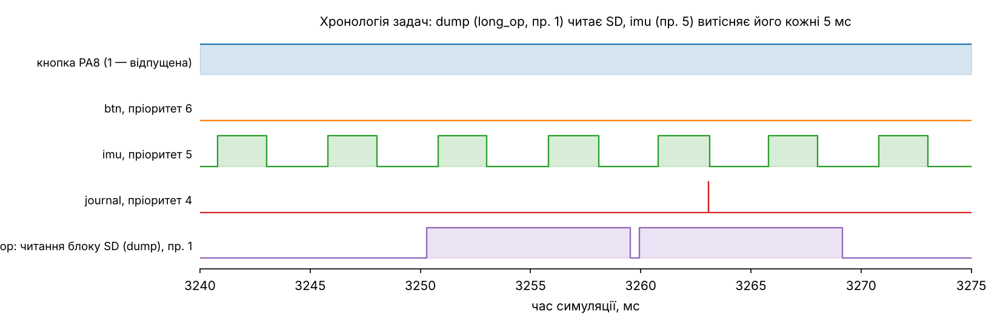

# Звіт з лабораторної роботи №4

**Та сама прошивка на FreeRTOS: задачі, пріоритети, IPC, вимірювання і порівняння з super loop**

Курс «Системне програмування вбудованих систем» · Проєкт: **Motion-Mirroring Teleoperator** (`docs/PRD.md`)
Форма виконання: **B (Wokwi)** · Плата: **NUCLEO-C031C6** (STM32C031C6T6, Cortex-M0+, 48 МГц, 32 КБ Flash, 12 КБ RAM)
Здача: pull request `lab4 → main`, тег `lab4` на фінальному коміті.

Виконавець: **Панюшкін Владислав Вадимович**, група ІО-34 (індивідуальне виконання — усі п'ять ролей, розд. 10).

> Обидві прошивки — тег `lab3` (`docs/metrics/fw/lab3.hex`) і поточна (`lab4.hex`) — прогнано
> тими самими 13 сценаріями ЛР3 у Wokwi CI **в один день, 25.11.2026** (`tools/run_lab4.sh`).
> Логи — `docs/metrics/lab3/`, `docs/metrics/lab4/`, `docs/metrics/os/`. Зведення —
> [`comparison.md`](comparison.md). Повна таблиця — [`comparison-data.md`](comparison-data.md).
> Схема задач — [`rtos-design.md`](rtos-design.md). Журнал проблем — [`lab4-journal.md`](lab4-journal.md).

## Зміст

1. Підсумок результатів
2. Статус функціональних вимог (обидва підходи)
3. Схема задач і взаємодії
4. Конфігурація ядра
5. Порівняння з ЛР3
6. Сценарії, специфічні для ОС
7. Хронологія задач
8. Журнал проблем
9. Висновок: який підхід обрати
10. Внесок учасників
11. Відеозвіт
12. Відповіді на контрольні питання

---

## 1. Підсумок результатів

| Вимога методички | Виконано | Де |
|---|---|---|
| Ті самі FR на FreeRTOS, той самий CLI і формат логів | ✅ усі 12 FR, CLI сумісний; нові команди лише додано: `tasks`, `trace`, `os …` (у збірці `OSTEST=1`) | розд. 2, `App/app_rtos.c` |
| Ядро зафіксованої версії в репозиторії | ✅ FreeRTOS-Kernel **V11.1.0** (`dbf70559`), порт `GCC/ARM_CM0`, `heap_4` | `firmware/Middlewares/FreeRTOS/VERSION.md` |
| Прошивка ЛР3 збирається з того самого репозиторію | ✅ тег `lab3`; `tools/fw_snapshot.sh` збирає її через `git worktree` | `docs/metrics/fw/` |
| Розбиття на задачі, пріоритети, IPC з обґрунтуванням | ✅ 7 задач + idle, 2 черги, 3 м'ютекси, 2 сповіщення з ISR | розд. 3 |
| Повтор усіх сценаріїв ЛР3 для обох прошивок в один день | ✅ 13 + 13 прогонів, 25.11.2026 | `docs/metrics/lab3/`, `lab4/` |
| Метрики ОС: CPU за задачами, стеки, heap, тік, перемикання | ✅ `tasks`, `os ctxsw`, `OSTICK` | розд. 5.2, `comparison.md` §2 |
| Перевірка гіпотез H1–H11 | ✅ 1 підтверджено повністю, 1 підтверджено й гірше за прогноз, 4 частково, 4 спростовано, 1 не перевірено | `comparison.md` §4 |
| Сценарії 7.2.1–7.2.6 | ✅ усі шість, з числами | розд. 6 |
| Порівняльна таблиця з абс./відн. різницею і вердиктом | ✅ 33 рядки (+ ≈ 440 автоматичних) | `comparison.md` §1 |
| Хронологія задач (trace / аналізатор) | ✅ `trace dump` (48 перемикань) і службові піни задач | розд. 7 |
| Журнал проблем ≥ 5, ≥ 2 специфічних для ОС | ✅ 11 записів (П-22 … П-32), 9 — специфічні для ОС | розд. 8 |
| Висновок з опорою на таблицю | ✅ | розд. 9 |
| Внесок, відео, тег `lab4` | ✅ / ▶ / ✅ | розд. 10–11 |

**Головне в трьох рядках.** Витіснення розв'язало проблему, через яку ЛР3 рекомендувала ОС.
Реакція на кнопку під час довгої операції: 933 → 54 мс. Пропуски IMU за 105 с: 547 → 13.
Записи журналу з інтервалом > 25 мс: 528 → 22. Ціна:
- RAM ×2.7, Flash +33 % (обидві вже на межі, 94 % і 97 %);
- CPU +25 п.п.;
- довгі операції в 7–24 рази повільніші;
- нові класи помилок: стан ядра, голодування, гонки, запаси стеків.

Найдорожчою виявилась проблема Форми B: модель Wokwi STM32C031 не маскує SysTick/PendSV через
PRIMASK (П-29). На ній ядро ламалося, доки не з'явився обхід.

## 2. Статус функціональних вимог (обидва підходи)

| FR | Вимога PRD | ЛР3 super loop | ЛР4 FreeRTOS | Статус ЛР4 |
|---|---|---|---|---|
| FR-01 | IMU 200 Гц ±2 % | S1: 132 Гц, 50 пропусків; S3: 233 пропуски | S1: 195 Гц (−2.3 %), 2 пропуски; S3: 36; 105 с: 13 | **з обмеженням** (на межі ±2 %; пропуски — тайм-аути I²C, П-31) |
| FR-02 | pitch/roll ≤ 3° у статиці | 30° → 29.64°, 45° → 44.91°, −30° → −29.45° | 30° → 29.74°, 45° → 44.95°, −30° → −29.74° | виконана |
| FR-03 | IMU → PWM ≤ 50 мс | max 2.30 мс (S2), 5.24 мс (S3); під час `dump`/`calib` серво стоять 0.6–1.4 с | max 6.45 мс (S2), 17.5 мс (S3); під час довгих операцій IMU працює (2.32 мс у `longop`) | **виконана** (у ЛР3 — з обмеженням) |
| FR-04 | dead-zone 0–10° з потенціометра | хостовий тест | той самий тест (105 тестів, `make -C tests`) | виконана |
| FR-05 | серво 0–180° (500–2500 мкс) | хостовий тест, `fr02_static` 45° → 1999 мкс | те саме: 1999 мкс | виконана |
| FR-06 | Live → Record → Playback кнопкою, debounce 50 мс | 30/30 у S3; реакція до 933 мс | 30/30 у S3; реакція ≤ 54 мс від першого фронту, 0.11 мс після debounce | **виконана** |
| FR-07 | запис ≥ 50 Гц, ≥ 60 с, без пропусків > 25 мс | 105 с: 528 пропусків, max 140 мс | 105 с: 22 пропуски, max 114 мс; S3: 0 | **з обмеженням** (−96 %) |
| FR-08 | темп відтворення ±2 % | S2: 20240 / 20240 мс | S2: 20394 / 20340 мс (+0.27 %) | виконана |
| FR-09 | траєкторія зберігається після вимкнення | журнал цілий після скиду; перерваний запис губиться | не переміряно: обрив з'єднання Wokwi; механізм журналу не змінювався | з обмеженням (як ЛР3) |
| FR-10 | OLED режим і кути ≥ 5 Гц | 4.9 кадр/с | 4.9 (S1), 4.6 (S3) | з обмеженням (на межі, як у ЛР3) |
| FR-11 | телеметрія і команди | під потоком губиться 469 Б; відповідь до 375 мс | 438 Б; відповідь до 69 мс; під відмовою I²C — телеметрія кожні 100 мс | виконана (з обмеженням під потоком) |
| FR-12 | перевірка MPU і SD на старті | `CHK imu=NACK`, серво 1500 мкс | те саме | виконана |

## 3. Схема задач і взаємодії

Повний документ — [`rtos-design.md`](rtos-design.md). Логіку кроків не переписано: вона лишилась
у `App/app.c` і покрита тими самими host-тестами. Задачі (`App/app_rtos.c`) визначають лише те,
**коли** кожен крок виконується. App не включає жодного заголовка ядра, усе йде через
`Interfaces/os.h` (`tools/check_deps.py`: 0 порушень).

| Задача | Пріоритет | Чекає на | Період / подія | Стек, Б | CPU у S3 | Запас стека після S3 |
|---|---:|---|---|---:|---:|---:|
| `btn` | **6** | сповіщення з tick hook | кнопка | 416 | 2.3 % | 96 Б |
| `imu` | **5** | `vTaskDelayUntil` | 5 мс | 560 | 48.3 % | 196 Б |
| `journal` | **4** | `q_rec` / `vTaskDelayUntil` | 20 мс | 448 | 1.0 % | 152 Б |
| `cmd` | **3** | сповіщення з USART RX ISR, тайм-аут 100 мс | рядок | 880 | 3.7 % | 364 Б |
| `telem` | 2 | `vTaskDelayUntil` | 100 мс (`telem`) | 480 | 3.4 % | 172 Б |
| `oled` | 2 | `vTaskDelayUntil` | 200 мс | 672 | 33.1 % | 204 Б |
| `long_op` | 1 | `q_long` | `dump`, `calib` | 624 | 7.9 % | 204 Б |
| idle | 0 | — | — | 256 | 0.1 % | 164 Б |

**Чому такі пріоритети.** Пріоритет залежить від жорсткості дедлайну, а не від «важливості».
- `btn` вищий за `imu`: реакція коротка (0.1 мс), а людина помічає затримку > 100 мс (у ЛР3
  було 933 мс).
- `imu` — найжорсткіший період (FR-01, FR-03).
- `journal` вищий за `cmd`: FR-07 (≤ 25 мс) — вимога продукту, а відповідь CLI — сервісна.
- `telem` = `oled`, з часовим квантуванням: обидві м'які.
- `long_op` найнижчий, бо `dump`/`calib` не мають дедлайну. Саме вони в ЛР3 блокували все інше.

**Взаємодія.**
- **Сповіщення з ISR:** tick hook → `btn`, USART RX (кінець рядка) → `cmd`. Це найдешевший
  механізм: окремого об'єкта в heap не потрібно.
- **Черга `q_rec`** (8 × `rec_item_t`): `imu` → `journal`. Розв'язує 5-мс IMU і запис SD
  тривалістю 4 мс. Мітка часу ставиться у відліку, тому інтервали журналу не залежать від SD.
- **Черга `q_long`** (4): `cmd` → `long_op`.
- **М'ютекси з успадкуванням пріоритету:**
  - `i2c_mx` (MPU-6050 + SSD1306 на одній шині) береться **на одну транзакцію**, тож `imu` чекає
    щонайбільше одну транзакцію OLED;
  - `jr_mx` захищає журнал, SD і режим;
  - `uart_mx` усередині `plat_log` не дає рядкам різних задач перемішуватися.

```
 SysTick ─tick hook─► notify ──► [btn 6] ──app_set_mode──► notify ──► [journal 4]
 USART2 RX ISR ───────► notify ──► [cmd 3] ──q_long──► [long_op 1]
 [imu 5] ──q_rec (8×8 Б)──► [journal 4] ──jr_mx──► SD (SPI)
 [imu 5], [oled 2], [cmd], [long_op] ──i2c_mx (на транзакцію)──► I²C1: MPU-6050 + SSD1306
 усі задачі ──uart_mx (у plat_log)──► USART2 TX
```

## 4. Конфігурація ядра

FreeRTOS-Kernel **V11.1.0**, порт **GCC/ARM_CM0** (ARMv6-M: без BASEPRI, без `CLZ`), heap
**`heap_4`**, тік **1000 Гц**. Повна таблиця з поясненнями — `rtos-design.md` §3. Нижче —
відмінності від типових значень:

| Параметр | Значення | Типове | Навіщо змінено |
|---|---|---|---|
| `configTICK_RATE_HZ` | 1000 (варіант 100) | 1000 | період IMU 5 мс має бути кратним тіку; при 100 Гц `vTaskDelayUntil` дає 10 мс (7.2.6) |
| `configMAX_PRIORITIES` | 7 | 5 | 0…6 — кожен рівень зайнятий, більше — зайві списки в RAM |
| `configMINIMAL_STACK_SIZE` | 64 слова | 128 | лише для idle (хука idle немає); HWM idle 92 Б |
| `configTOTAL_HEAP_SIZE` | 5 888 Б (`OSTEST`: 7 168) | — | 7 стеків 3 952 Б + TCB + черги + м'ютекси + idle; після S3 вільно 216 Б |
| `configUSE_TIME_SLICING` | 1 | 1 | `telem` і `oled` з рівним пріоритетом ділять час |
| `configUSE_PORT_OPTIMISED_TASK_SELECTION` | 0 | — | на ARMv6-M немає `CLZ` |
| `configCHECK_FOR_STACK_OVERFLOW` | 2 (варіант 0) | 0 | 7.2.2; хук друкує `FATAL stack overflow task=…` |
| `configUSE_MALLOC_FAILED_HOOK` | 1 | 0 | 7.2.5; `HOOK malloc_failed free=…` |
| `configUSE_TICK_HOOK` | 1 | 0 | час HAL (`HAL_IncTick`) і debounce кнопки в тіку, як у ЛР3 |
| `configGENERATE_RUN_TIME_STATS` | 1, лічильник `plat_us()` | 0 | CPU за задачами (`tasks`) |
| `configUSE_TRACE_FACILITY` | 0 | 0 | `uxTaskGetSystemState` не влазив у Flash; `tasks` обходить власний реєстр |
| `configUSE_TIMERS` | 0 | 0 | без daemon-задачі економиться ≈ 1 КБ RAM |
| `configUSE_MINI_LIST_ITEM` | 0 | 1 | +96 Б RAM; ядро без strict aliasing (П-27, перестраховка) |
| `configKERNEL_INTERRUPT_PRIORITY` | 0xC0 (3) | — | SysTick і PendSV — найнижчий пріоритет; USART2 теж 3 (П-29) |
| `traceTASK_SWITCHED_IN` | `os_trace_switched_in()` | — | лічильник перемикань, кільце `trace`, службові піни задач |
| збірка | `-Os -flto`; порт без LTO | — | без LTO не влазить у 32 КБ (П-23, П-24) |

**Таймбаза HAL.** Окремого таймера під HAL немає. SysTick належить ядру, а `HAL_IncTick`
викликається з tick hook з кроком `uwTickFreq = 1000 / TICK_HZ`. До старту планувальника
SysTick обслуговує обгортка в `os_simfix.c`. Тому `HAL_Delay` в ініціалізації пристроїв працює,
а після старту `plat_delay_ms` іде у `vTaskDelay`.

**Обхід симулятора (П-29).** `SysTick_Handler`/`PendSV_Handler` відкладають тік і перемикання,
поки `ulCriticalNesting != 0`. Детально — розд. 8 і `rtos-design.md` §2.1.

## 5. Порівняння з ЛР3

### 5.1 Зведена таблиця (скорочено)

Повна таблиця на 33 рядки з примітками — [`comparison.md`](comparison.md) §1. Тут лише
рядки з вимогою PRD і ключові ціни:

| Метрика | Сценарій | ЛР3 | ЛР4 | Різниця | Вимога | Хто кращий |
|---|---|---:|---:|---:|---|---|
| Кнопка: фронт → реакція, max | 6.2.2 | 933.4 мс | 54.1 мс | −879 мс, ÷17 | FR-06 | **FreeRTOS** |
| Кнопка під `calib` (аналізатор), max | `vcd_btn` | 1352.7 мс | 53.2 мс | ÷25 | FR-06 | **FreeRTOS** |
| Джитер IMU, max | S3 | 593.6 мс | 111.0 мс | −81 % | FR-01 | FreeRTOS (обидва ✗) |
| Пропущені періоди IMU | 105 с | 547 | 13 | −98 % | FR-01: 0 | FreeRTOS (обидва ✗) |
| Записи журналу > 25 мс | 105 с | 528 | 22 | −96 % | FR-07: 0 | FreeRTOS (обидва ✗) |
| Відповідь на команду, max | 6.2.3 | 375 мс | 69 мс | −82 % | FR-11 | **FreeRTOS** |
| Телеметрія під відмовою I²C, max інтервал | 6.2.4 | 1058 мс | 152 мс | ÷7 | FR-11 | **FreeRTOS** |
| IMU → PWM, max | S3 | 5.24 мс | 17.5 мс | +233 % | FR-03: ≤ 50 мс | обидва ✓ |
| `dump` / `calib` | 6.2.1 | 1.0 / 1.4 с | 7.6 / 33.8 с | ×7 / ×24 | — | **super loop** |
| CPU у простої | S1 | 61 % | 85 % | +24 п.п. | — | **super loop** |
| Тік ядра | S3 | 0 | 27.8 мкс/мс = 2.8 % | — | — | **super loop** |
| Тайм-аути I²C | S3 | 1 | 24 | ×24 | 0 | **super loop** (П-31) |
| Flash / RAM | — | 24.0 / 4.3 КБ | 31.9 / 11.5 КБ | +33 % / ×2.7 | 32 / 12 КБ | **super loop** |
| NLOC власного коду | — | 1 998 | 2 962 | +48 % | — | super loop |

### 5.2 Метрики ОС (S3)

- **CPU за задачами:** imu 48.3 %, oled 33.1 %, long_op 7.9 %, cmd 3.7 %, telem 3.4 %,
  btn 2.3 %, journal 1.0 %, idle **0.1 %** (`os/s3_os.log`).
- **Тік:** 18.8 / 27.8 / 117.7 мкс (min/avg/max) при 1 кГц, тобто 2.8 % CPU лише на ядро.
- **Перемикання контексту:** 691/с.
  - Ціна `xTaskNotifyGive` → задача з вищим пріоритетом: 6 651 такт ≈ 139 мкс (`os ctxsw`,
    200 повторів).
  - ISR → задача (тік → `btn`): 107–109 мкс.
- **Heap ОС:** 5 888 Б, мінімум вільного 216 Б, відмов 0.
- **Стеки:** таблиця в розд. 3. Найменший запас у `btn` (96 Б = 23 %): реакція на кнопку пише SD
  (`rec_stop`). Це перший кандидат на перенесення в `journal`.

**Чому CPU 100 %, хоча ядро бере лише 3 %.** Драйвери I²C працюють опитуванням: `imu` і `oled`
активно чекають шину. У super loop це очікування теж було, але воно розтягувало цикл, а не
завантаження. Справжній виграш ОС тут з'явиться лише з драйвером на перериваннях або DMA.
Тоді задачі блокуватимуться на час транзакції, і idle отримає ці ≈ 80 %.

### 5.3 Перевірка гіпотез H1–H11

Повні записи у форматі методички (гіпотеза → механізм → результат → вердикт → ціна → нова
проблема) — [`comparison.md`](comparison.md) §4. Зведення:

| # | Обмеження ЛР3 | Очікування | ЛР3 → ЛР4 | Вердикт |
|---|---|---|---|---|
| H1 | IMU vs кадр OLED (S1) | missed 0, джитер ≤ 4 мс | 50 / 66 мс → 2 / 90 мс (p99: ≥ 100 → 2 мс) | частково |
| H2 | пропуски журналу (105 с) | 0 | 528 → 22 | частково |
| H3 | кнопка під довгою операцією | ≤ 70 мс | 933 → 54 мс | **підтверджено** |
| H4 | IMU під довгими операціями | missed ≤ 5 | 437 → 72 | частково |
| H5 | UART RX під `dump` | 0 втрат | 469 → 438 | спростовано |
| H6 | телеметрія під відмовою I²C | ≤ 110 мс | 1058 → 152 мс (avg 100) | частково |
| H7 | точка зламу IMU | ≈ 400 Гц ±10 % | 400 → 333 Гц | спростовано |
| H8 | Flash / вільна RAM | ≈ 90 % / < 4 КБ | 73 % / 8 КБ → 97 % / 0.75 КБ | підтверджено (гірше) |
| H9 | IMU → PWM (S2) | ≤ 3 мс | 2.30 → 6.45 мс | спростовано (FR-03 виконана) |
| H10 | втрата запису при скиді | ≤ 1 блок | — | не перевірено |
| H11 | тайм-аути I²C від натискань | 0 | 7 → 47 | спростовано, погіршено (П-31) |

**Що super loop робить краще (список з ЛР3)?** Підтвердилось усе: менша вартість (2.8 % тіку і
691 перемикання/с), пам'ять (+33 % / ×2.7), швидкі довгі операції (`dump` 1.0 проти 7.6 с) і
простіше налагодження (П-26 … П-29 знаходили годинами).

## 6. Сценарії, специфічні для ОС

Збірки й сценарії:
- `OSTEST=1` — `tests/sim/lr4_os.yaml`, лог `os/os_tests.log`;
- `STACK_CHECK=0` — `nocheck.log`;
- `HEAP_BYTES=3000` — `heapsmall.log`;
- `TICK_HZ=100` — `s3_tick100.log`.

| § | Що зроблено | Результат | Пояснення |
|---|---|---|---|
| 7.2.1 Інверсія пріоритетів | L(1) тримає ресурс 50 мс CPU-роботи, H(5) просить його, M(4) крутиться 300 мс; продукт на час досліду призупинено | **м'ютекс:** `h_wait_us=49516`; **двійковий семафор:** `h_wait_us=300604`, `l_hold_us=300828` | З м'ютексом L успадковує пріоритет 5, тож M його не витісняє: H чекає лише залишок роботи L. З семафором L стоїть, поки M не відпрацює 300 мс: класична інверсія, H чекає в 6 разів довше |
| 7.2.2 Переповнення стека | задача на 64 слова рекурсивно з'їдає ≈ 400 Б | з контролем (2): `FATAL stack overflow task=ovf`, зупинка; без контролю: `OVF survived (check disabled?)` → `OVF end (no hook)`, продукт далі відповідає (`STATUS …`) | Без контролю переповнення тихо перезаписує сусідній блок heap. Це рівно той клас помилок, що й П-27: симптом виникає далеко від причини |
| 7.2.3 Голодування | задача з пріоритетом 6 крутиться 300 мс без блокування | `imu` JIT max 297 мс, missed 1; `LOAD 100 %`; у `tasks` задача `starve` 16.4 % CPU, `IDLE run_us=0`, `telem` 0.1 % | Нижчі задачі й idle не виконуються зовсім, і це видно в run-time stats. Те саме в продукті: П-28 (`imu` під відмовою I²C), П-30 (`dump` при CPU 100 %) |
| 7.2.4 Вичерпання черги | виробник 1/мс, споживач 10 мс/елемент, черга на 8, 50 подій | без очікування: надіслано 21, **втрачено 29** за 165 мс; з тайм-аутом 50 мс: надіслано 50, втрат 0, max очікування виробника 20.1 мс | Втрати видно в лічильнику відправника; в продукті — `QREC drops` (0 у всіх сценаріях). З блокуванням виробник гальмується до темпу споживача |
| 7.2.5 Вичерпання heap | `os heap`: блоки по 128 Б до відмови; збірка з heap 3000 Б | 8 блоків, `HOOK malloc_failed` ×2, після цього `xQueueCreate` → FAIL, пам'ять повернено. Heap 3000: `FATAL os_task_new cmd/oled/long_op`, і далі `FATAL assert tasks.c:3753` (idle не створюється) | Хук спрацьовує і програма лишається керованою, якщо перевіряти результат створення (`FATAL os_task_new`). Без місця для idle ядро не стартує взагалі |
| 7.2.6 Частота тіку 1000 → 100 Гц | S3 на збірці `TICK_HZ=100` | IMU: період 5 мс округлено до 10 мс, тобто фактично 100 Гц; JIT p99 20 мс, missed 1177. Кнопка: debounce → реакція 107–109 мкс (не змінилось) | Роздільна здатність `vTaskDelayUntil` — 1 тік. При 100 Гц FR-01 не виконується принципово. Накладні тіку падають у 10 разів, але для 5-мс періоду потрібен тік ≥ 200 Гц |

## 7. Хронологія задач

**Trace ядра.** Команда `trace start` перед `dump` записала 48 перемикань із мітками
`plat_us()`. Фрагмент з `os/s3_os.log`:

```
TR t_us=8398107 task=imu        ← період IMU
TR t_us=8398324 task=oled
TR t_us=8401436 task=long_op    ← dump почався (EVT dump_start 8401507)
TR t_us=8403106 task=imu        ← imu витісняє long_op через 1.7 мс
TR t_us=8405538 task=long_op
TR t_us=8407596 task=imu        ← і знову, рівно через 5 мс від попереднього
TR t_us=8410931 task=imu
TR t_us=8415924 task=journal
TR t_us=8416133 task=cmd
TR t_us=8416294 task=telem
```

**Аналізатор (службові піни задач, `trace pins`, `docs/captures/lr4_tasks.vcd`):**
- **Канали:** `P_IMU` — `imu` виконується; `P_PWM` — `journal`; `P_LONG` — операція SD у
  `long_op`; `MARK` — `btn`.
- **Що видно на рис. 1:** під час читання блоку SD у `dump` (P_LONG = 1, 3250–3269 мс) задача
  `imu` отримує процесор кожні 5 мс, а `dump` продовжується після неї. Це витіснення. У ЛР3 на
  цьому місці була б «дірка» в P_IMU на всю тривалість `dump` (у `lr4_btn_lab3.vcd`: інтервал
  P_IMU до 1.5 с).



▶ СКРІНШОТ 1 — PulseView, `docs/captures/lr4_tasks.vcd`, фрагмент 3240–3275 мс (канали BTN,
P_IMU, P_PWM, P_LONG, MARK): видно імпульси P_IMU кожні 5 мс поверх тривалого P_LONG.

▶ СКРІНШОТ 2 — PulseView, `docs/captures/lr4_btn_lab4.vcd` і `lr4_btn_lab3.vcd` поруч: натискання
під час `calib` (≈ 6716 мс). ЛР4: BTN → MARK 53 мс; ЛР3: 1053 мс.

## 8. Журнал проблем

Повні записи (симптом → причина → виправлення → коміт) — [`lab4-journal.md`](lab4-journal.md).
Позначка [ОС] — проблема, якої немає в super loop.

| № | Коротко | Тип | Виправлення / статус | Коміт |
|---|---|---|---|---|
| П-22 | Створення об'єктів ОС до `app_start` вішало `HAL_Delay` | [ОС] | об'єкти — в `app_rtos_start` | `ef64218` |
| П-23 | Ядро не влазить у Flash (+6.6 КБ) | — | LTO, власний `parse_long`, тести ОС в окремій збірці | `ef64218` |
| П-24 | LTO ламає літеральні пули асемблера порту | — | `port.o`, `portasm.o` без LTO | `ef64218` |
| П-25 | Запас стека `telem` 44 Б; статична оцінка занижена | [ОС] | стеки за HWM + ≥ 25 % | `510884f`, `d47fa71` |
| П-26 | Подвійне читання `telem_ms`, змінюваного іншою задачею | [ОС] | одне читання | `510884f` |
| П-27 | «Неможливий» стан ядра: `FATAL assert`, задача `ready`, але не виконується, `unaligned read` | [ОС] | діагностична збірка → причина П-29 | `4ccce85` |
| П-28 | Під відмовою I²C `imu` (пр. 5) голодує решту | [ОС] | повтор не частіше ніж раз на 50 мс | `4ccce85` |
| П-29 | **Wokwi не маскує SysTick/PendSV через PRIMASK** | [ОС], Форма B | обгортки обробників, відкладання в критичній секції | `4ccce85` |
| П-30 | Голодування `dump` при CPU 100 % | [ОС] | задокументовано; лікування — драйвер I²C на перериваннях | — |
| П-31 | Тайм-аути I²C ×7–24 (опитувальний драйвер + витіснення) | [ОС] | **відкрита** | — |
| П-32 | Тест інверсії отримував чуже сповіщення | [ОС] | прапорець + ізоляція від продукту | `d1bc7a2` |

**П-29 детальніше — найдорожча проблема ЛР4.**
- **Симптом.** У 5 сценаріях із записом і рухом IMU симулятор зупинявся з
  `read from address 29, which is not 32 bit aligned` (`lab4/*.err` першого прогону).
- **Діагностика.** Збірка `DIAG=1`: перевірка списків ядра в idle hook через
  `freertos_tasks_c_additions.h`. Вона показала зіпсований список затриманих задач:
  `list=delayed1 count walk=6 stored=5`.
- **Хибні гіпотези.** Стек `telem` і strict aliasing у списках — обидві не підтвердились.
- **Прямий тест.** `PRIMASK_TEST ticks_masked=405`, `CRIT_TEST ticks_in=709 ctxsw_in=318`:
  у критичній секції проходять тіки й перемикання.
- **Після обходу.** `CRIT_TEST ticks_in=0 ctxsw_in=0`, діагностика мовчить, усі сценарії
  проходять.
- **Як знайти швидше.** Коли бачиш «неможливий» стан ядра, спочатку перевіряй базові
  припущення порту коротким тестом.

## 9. Висновок: який підхід обрати

**Для цього продукту — FreeRTOS, але з двома умовами.** Аргументи з таблиці:

1. Головна вимога, яку super loop не виконував, — реакція й періодичність під довгими
   операціями. Тут FreeRTOS дає різницю на порядки:
   - кнопка: 933 → 54 мс;
   - пропуски IMU за 105 с: 547 → 13;
   - пропуски журналу: 528 → 22;
   - телеметрія під відмовою шини: 1058 → 152 мс.

   Super loop можна наблизити до цього лише поділом `dump`/`calib` на кроки, тобто власним
   кооперативним планувальником.
2. Ціна суттєва, але в межах ресурсів МК. RAM 94 % і Flash 97 % — це межа C031: нової задачі
   вже не додати. Довгі операції в 7–24 рази повільніші. CPU 85–100 %.

**Умови, без яких вибір не має сенсу:**
- **Драйвер I²C на перериваннях або DMA.** Без нього ОС лише перерозподіляє активне очікування:
  CPU 100 %, голодування `dump` (П-30), тайм-аути (П-31). З ним `imu` і `oled` блокуватимуться на
  час транзакції, і звільниться ≈ 80 % CPU (оцінка за run-time stats).
- **МК з більшою RAM** (напр., STM32G0 або C071 на 24–36 КБ). Тоді з'явиться запас на стеки й
  черги.

**Коли вибір змінився б на super loop:**
- якщо прибрати з PRD довгі операції (`dump`, `calib`) або дозволити їм зупиняти стабілізацію
  (наприклад, лише в режимі сервісу);
- якщо ціна МК змушує лишитися на C031;
- якщо вимоги до реакції кнопки ≥ 1 с.

Тоді super loop виконує FR-01/FR-07 з дробленням OLED (`oled 2`, ЛР3 6.2.5) і коштує у 2.7 раза
менше RAM і 25 п.п. CPU.

## 10. Внесок учасників

Робота індивідуальна: усі п'ять ролей розділу 8 методички виконав Панюшкін В. В. (git-історія
гілки `lab4`).

| № | Роль | Відповідальний | Артефакти |
|---:|---|---|---|
| 1 | Розробка на FreeRTOS | Панюшкін В. В. | `firmware/Middlewares/FreeRTOS/`, `Core/Inc/FreeRTOSConfig.h`, `App/app_rtos.c`, `Platform/os_freertos.c`, `Core/Src/os_simfix.c`, `docs/rtos-design.md` |
| 2 | Метрики | Панюшкін В. В. | команди `tasks`, `trace`, `os ctxsw`, `OSTICK`; `tools/lr4_compare.py`, `tools/stack_tree.py`, `tools/lr4_trace_plot.py` |
| 3 | Тестування | Панюшкін В. В. | `tests/sim/lr4_*.yaml`, `tools/lr4_gen_scenarios.py`, `docs/comparison.md` |
| 4 | Тестування на обладнанні (Wokwi) | Панюшкін В. В. | `tools/run_lab4.sh`, `docs/metrics/{lab3,lab4,os}/`, `docs/captures/lr4_*.vcd` |
| 5 | Звіт | Панюшкін В. В. | `docs/lab4-report.md`, `docs/lab4-journal.md`, відео |

## 11. Відеозвіт

▶ ВІДЕО — посилання: `<додати після запису>` (2–3 хв). Вміст:
1. Обидві прошивки в S3 по черзі (`lab3.hex`, потім `lab4.hex`): натискання кнопки під час
   `calib`. У ЛР3 режим перемикається через ≈ 1 с, у ЛР4 — одразу.
2. Вивід `tasks` після S3: CPU за задачами, `stack_free_min`, `HEAP`, `OSTICK`, `CTXSW`.
3. Фрагмент хронології задач у PulseView (`lr4_tasks.vcd`).

## 12. Відповіді на контрольні питання

1. **Blocked і Ready.** Blocked — задача чекає подію або час і не бере участі у виборі
   планувальника. Ready — готова, але виконується задача з вищим пріоритетом. У Blocked задача
   не споживає CPU. У super loop «очікування» — це перевірка прапорців на кожному проході
   (опитування).
2. **Витіснення.** ISR кличе `vTaskNotifyGiveFromISR`, і задача переходить у Ready. Якщо її
   пріоритет вищий за поточну, виставляється `PENDSVSET`. Після виходу з ISR (tail-chaining)
   PendSV зберігає контекст і кличе `vTaskSwitchContext`, а далі відновлює нову задачу. Від тіку
   до `btn` виміряно 107–109 мкс.
3. **`vTaskDelay` і `vTaskDelayUntil`.** `vTaskDelay` відлічує від моменту виклику, тож похибка
   накопичується. `vTaskDelayUntil` відлічує від попереднього пробудження. Для `imu` використано
   `vTaskDelayUntil`: медіанний інтервал P_IMU на аналізаторі — 4999.9 мкс (у ЛР3 5006.9 мкс,
   з дрейфом).
4. **Роздільна здатність.** 1 тік = 1 мс. Період IMU, запитаний як 3.33 мс (`rate 300`),
   округлюється до 3 мс. При 100 Гц 5 мс перетворюються на 10 мс (7.2.6).
5. **Лише FromISR з переривань.** Звичайні функції можуть блокуватися або змінювати списки
   без захисту від ISR. FromISR не блокуються і повертають «треба перемкнути». На Cortex-M0
   немає `BASEPRI` і `configMAX_SYSCALL_INTERRUPT_PRIORITY`: критична секція — це PRIMASK.
   SysTick, PendSV, USART2 і EXTI мають пріоритет 3 (П-29).
6. **М'ютекс і двійковий семафор.** М'ютекс має власника й успадковує пріоритет. Інверсія —
   високопріоритетна задача чекає ресурс, який тримає низькопріоритетна, а ту витісняє середня.
   Виміряно: H чекав 49.5 мс з м'ютексом і 300.6 мс із семафором.
7. **Сповіщення чи черга.** Сповіщення — коли один відомий отримувач і треба лише «прокинься»
   або лічильник (ISR → `btn`, ISR → `cmd`). Черга — коли передаються дані або отримувачів
   кілька (`q_rec`, `q_long`). Семафор чи м'ютекс — для ресурсу.
8. **Розмір стека.** Нижня межа — статична оцінка (`tools/stack_tree.py` за
   `-fcallgraph-info=su`), остаточний розмір — HWM після S3 + ≥ 25 %. Найменший запас — `btn`,
   96 Б (23 %). Перевірено контролем переповнення (2) і HWM у кожному прогоні.
9. **Приріст пам'яті.** RAM: heap ОС 5 888 Б, з них стеки задач 3 952 Б. Це найбільша складова,
   і зменшити її можна лише меншою кількістю задач. Flash: ядро ≈ 6.5 КБ після LTO.
10. **Вартість ядра.** Тік у середньому 27.8 мкс при 1 кГц, тобто 2.8 % CPU. Перемикання
    зі сповіщенням — ≈ 139 мкс. Разом із 691 перемиканням/с ядро бере ≈ 3–5 % CPU.
11. **Що ОС розв'язала найкраще і що не розв'язала.** Найкраще — реакцію на подію під довгою
    операцією (H3: ÷17). Не розв'язала зовсім — втрати UART RX під потоком (H5) і тайм-аути
    I²C (H11): це питання драйверів, а не планування.
12. **Нові класи помилок.**
    - гонки на спільних змінних (П-26);
    - голодування (П-28, П-30);
    - запаси стеків (П-25);
    - неузгоджений стан ядра (П-27, через П-29);
    - чужі сповіщення (П-32).

    Виявлено діагностичною збіркою (перевірка списків), run-time stats, HWM і прямими тестами.
13. **Коли super loop.** Коли немає довгих операцій поруч із жорсткими періодами або коли
    RAM ≤ 12 КБ. Числа: ×2.7 RAM, +25 п.п. CPU, `dump` ×7. Для продукту лише з IMU + PWM
    super loop вистачає: у ЛР3 з `oled 2` IMU мав 199 Гц і 0 пропусків.
