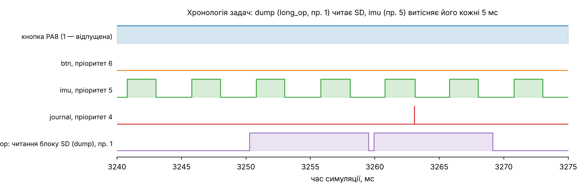

**Тема:** Перенесення прошивки продукту на FreeRTOS: розбиття на задачі, механізми взаємодії, вимірювання і порівняння з super loop.

**Мета роботи:** реалізувати ті самі функціональні вимоги PRD продукту Motion-Mirroring Teleoperator, що й у ЛР3, на операційній системі реального часу FreeRTOS. Спроєктувати задачі, пріоритети й механізми взаємодії, повторити всі вимірювання базової лінії ЛР3 тим самим методом для обох прошивок, перевірити гіпотези з реєстру обмежень ЛР3, знайти нові проблеми, яких не було в super loop, і зробити обґрунтований висновок, який підхід підходить продукту. Роботу виконано у формі B (симулятор Wokwi) на платі NUCLEO-C031C6 (STM32C031C6, Cortex-M0+, 48 МГц, 32 КБ Flash, 12 КБ RAM). Репозиторій: https://github.com/NightcoreBomb/repo, гілка і тег lab4.

**Виконання лабораторної роботи**

# 1. Ядро і збірка

FreeRTOS-Kernel V11.1.0 (коміт dbf70559) скопійовано в `firmware/Middlewares/FreeRTOS/` із записом версії, порту і внесених змін у `VERSION.md`. Порт — `GCC/ARM_CM0` (ARMv6-M: без BASEPRI і без інструкції CLZ), керування пам'яттю — `heap_4`, тік — 1000 Гц. Прошивка ЛР3 лишається збираною з того самого репозиторію (тег `lab3`, `tools/fw_snapshot.sh`).

Ядро разом із прошивкою ЛР3 не вміщувалось у 32 КБ (+6.6 КБ). Довелося ввімкнути LTO (без нього для асемблерного порту — П-23, П-24) і винести тести ОС в окрему збірку. Підсумок — Flash 31 896 Б (97 %), RAM 11 520 Б (94 %).

▶ СКРІНШОТ 1 — термінал: `make -C firmware` (кінець виводу з таблицею `Memory region … RAM … FLASH`) і `make -C tests` (`ALL TESTS PASSED`).

# 2. Схема задач і взаємодії (docs/rtos-design.md)

Логіку кроків ЛР3 не переписано: функції `app_imu_run`, `app_rec_drain`, `app_oled_run` та інші лишились у `App/app.c` і покриті тими самими 105 host-тестами. Задачі в `App/app_rtos.c` визначають лише те, коли кожен крок виконується. Прикладний шар не включає заголовків ядра — лише інтерфейс `Interfaces/os.h`.

| Задача | Пріоритет | Чекає на | Період / подія | Стек, Б | CPU у S3 | Запас після S3 |
|---|---:|---|---|---:|---:|---:|
| btn | 6 | сповіщення з tick hook | кнопка | 416 | 2.3 % | 96 Б |
| imu | 5 | vTaskDelayUntil | 5 мс | 560 | 48.3 % | 196 Б |
| journal | 4 | черга q_rec / vTaskDelayUntil | 20 мс | 448 | 1.0 % | 152 Б |
| cmd | 3 | сповіщення з USART RX ISR | рядок | 880 | 3.7 % | 364 Б |
| telem | 2 | vTaskDelayUntil | 100 мс | 480 | 3.4 % | 172 Б |
| oled | 2 | vTaskDelayUntil | 200 мс | 672 | 33.1 % | 204 Б |
| long_op | 1 | черга q_long | dump, calib | 624 | 7.9 % | 204 Б |
| idle | 0 | — | — | 256 | 0.1 % | 164 Б |

Пріоритети призначено за жорсткістю дедлайну:

- кнопка — найвищий: реакція коротка (0.1 мс), а затримку понад 100 мс людина помічає (у ЛР3 вона доходила до 933 мс);
- IMU — найжорсткіший період (FR-01, FR-03);
- журнал вищий за CLI, бо FR-07 (інтервал ≤ 25 мс) — вимога продукту;
- телеметрія й OLED рівні, з часовим квантуванням;
- довгі операції `dump` і `calib`, які в ЛР3 блокували все, — найнижчий пріоритет.

Механізми взаємодії:

- сповіщення з переривань: tick hook → btn, USART RX → cmd;
- черга `q_rec` на 8 записів: imu → journal; розв'язує 5-мс IMU і 4-мс запис блоку SD;
- черга `q_long`: cmd → long_op;
- три м'ютекси з успадкуванням пріоритету:
  - I²C — береться на одну транзакцію, тож IMU чекає щонайбільше одну транзакцію OLED;
  - журнал/SD;
  - UART-вивід.

▶ СКРІНШОТ 2 — термінал Wokwi після команди `tasks`: таблиця задач з пріоритетами, станами, CPU і `stack_free_min`, рядки `HEAP`, `OSTICK`, `CTXSW`.

# 3. Конфігурація ядра (Core/Inc/FreeRTOSConfig.h)

| Параметр | Значення | Навіщо |
|---|---|---|
| configTICK_RATE_HZ | 1000 (варіант 100) | період IMU 5 мс має бути кратним тіку |
| configMAX_PRIORITIES | 7 | 0…6, кожен рівень зайнятий |
| configTOTAL_HEAP_SIZE | 5 888 Б | 7 стеків (3 952 Б) + TCB + черги + м'ютекси + idle; після S3 вільно 216 Б |
| configCHECK_FOR_STACK_OVERFLOW | 2 | хук `FATAL stack overflow task=…` (сценарій 7.2.2) |
| configUSE_MALLOC_FAILED_HOOK | 1 | `HOOK malloc_failed` (7.2.5) |
| configUSE_TICK_HOOK | 1 | час HAL (`HAL_IncTick`) і debounce кнопки в тіку |
| configGENERATE_RUN_TIME_STATS | 1 | CPU за задачами, лічильник — `plat_us()` |
| configUSE_TIMERS | 0 | без daemon-задачі — мінус ≈ 1 КБ RAM |
| configKERNEL_INTERRUPT_PRIORITY | 0xC0 | SysTick, PendSV і USART2 мають однаковий пріоритет 3 |

**Обмеження симулятора (П-29).** Модель Wokwi STM32C031 не маскує SysTick і PendSV інструкцією `cpsid i`. Тест показав 405 тіків під `cpsid i` і 318 перемикань контексту всередині `taskENTER_CRITICAL`. На Cortex-M0 критична секція FreeRTOS — це саме PRIMASK, тож у симуляторі ядро ламалося. Обхід — обгортки обробників (`Core/Src/os_simfix.c`): поки ядро в критичній секції, тік і перемикання відкладаються. На справжньому МК ці гілки не виконуються.

▶ СКРІНШОТ 3 — вивід сценарію `lr4_primask.yaml`: рядки `PRIMASK_TEST ticks_masked=405 …` і `CRIT_TEST ticks_in=0 ctxsw_in=0 …` (після обходу).

# 4. Вимірювання: ті самі сценарії для обох прошивок

Обидві прошивки — тег `lab3` і поточна — прогнано тими самими 13 сценаріями ЛР3 у Wokwi CI 25.11.2026 однією командою (`tools/run_lab4.sh`, по одній тимчасовій теці проєкту на кожен .hex). Таблицю порівняння будує `tools/lr4_compare.py`.

▶ СКРІНШОТ 4 — термінал після `bash lr4_measure3.sh`: список сценаріїв з `exit=0` і блок «підсумок» (токен Wokwi у кадр не потрапляє).

| Метрика | Сценарій | ЛР3 super loop | ЛР4 FreeRTOS | Різниця | Вимога | Хто кращий |
|---|---|---:|---:|---:|---|---|
| Кнопка: фронт → реакція, max | подія під час довгої операції | 933.4 мс | 54.1 мс | ÷17 | FR-06 | FreeRTOS |
| Те саме, аналізатор | натискання під calib | 1352.7 мс | 53.2 мс | ÷25 | FR-06 | FreeRTOS |
| Джитер IMU, max | S3 | 593.6 мс | 111.0 мс | −81 % | FR-01 | FreeRTOS (обидва ✗) |
| Пропущені періоди IMU | 105 с | 547 | 13 | −98 % | FR-01: 0 | FreeRTOS (обидва ✗) |
| Записи журналу > 25 мс | 105 с | 528 | 22 | −96 % | FR-07: 0 | FreeRTOS (обидва ✗) |
| Записи журналу > 25 мс | S3 | 4 | 0 | −100 % | FR-07 | FreeRTOS |
| Відповідь на команду, max | потік UART + dump | 375 мс | 69 мс | −82 % | FR-11 | FreeRTOS |
| Втрачені байти UART | потік UART + dump | 469 | 438 | −7 % | 0 | обидва ✗ |
| Телеметрія під відмовою I²C | SDA затиснута | 1058 мс | 152 мс | ÷7 | FR-11 | FreeRTOS |
| IMU → PWM, max | S3 | 5.24 мс | 17.5 мс | +233 % | FR-03: ≤ 50 мс | обидва ✓ |
| Тривалість dump / calib | довга операція | 1.0 / 1.4 с | 7.6 / 33.8 с | ×7 / ×24 | — | super loop |
| Точка зламу IMU | rate | ≈ 400 Гц | 333 Гц | −17 % | — | super loop |
| CPU у простої | S1 | 61 % | 85 % | +24 п.п. | — | super loop |
| Тік ядра | S3 | 0 | 27.8 мкс/мс = 2.8 % | — | — | super loop |
| Тайм-аути I²C | S3 | 1 | 24 | ×24 | 0 | super loop |
| Flash / RAM | — | 24.0 / 4.3 КБ | 31.9 / 11.5 КБ | +33 % / ×2.7 | 32 / 12 КБ | super loop |
| Рядків власного коду (lizard) | — | 1 998 | 2 962 | +48 % | — | super loop |

Повна таблиця на 33 рядки з примітками — `docs/comparison.md`. Автоматична, з усіма блоками статистики, — `docs/comparison-data.md`.

**Метрики ОС після S3:**

- **CPU за задачами:** imu 48 %, oled 33 %, long_op 8 %, idle 0.1 %.
- **Тік:** min 18.8 / avg 27.8 / max 117.7 мкс.
- **Перемикання:** 691 за секунду; «сповіщення → задача з вищим пріоритетом» коштує 6 651 такт ≈ 139 мкс.
- **ISR → задача:** 107–109 мкс.
- **Heap:** мінімум вільного 216 Б.

CPU завантажений на 100 % не через ядро (≈ 3 %), а через драйвери I²C на опитуванні: задачі IMU та OLED активно чекають шину.

# 5. Перевірка гіпотез з ЛР3

| № | Обмеження ЛР3 | Очікування | ЛР3 → ЛР4 | Вердикт |
|---|---|---|---|---|
| H1 | IMU і кадр OLED (S1) | пропусків 0, джитер ≤ 4 мс | 50 / 66 мс → 2 / 90 мс | частково |
| H2 | пропуски журналу, 105 с | 0 | 528 → 22 | частково |
| H3 | кнопка під довгою операцією | ≤ 70 мс | 933 → 54 мс | підтверджено |
| H4 | IMU під довгими операціями | пропусків ≤ 5 | 437 → 72 | частково |
| H5 | втрати UART під dump | 0 | 469 → 438 | спростовано |
| H6 | телеметрія під відмовою I²C | ≤ 110 мс | 1058 → 152 мс | частково |
| H7 | точка зламу IMU | ≈ 400 Гц ±10 % | 400 → 333 Гц | спростовано |
| H8 | Flash / вільна RAM | ≈ 90 % / < 4 КБ | 97 % / 0.75 КБ | підтверджено (гірше) |
| H9 | IMU → PWM (S2) | ≤ 3 мс | 2.30 → 6.45 мс | спростовано |
| H10 | втрата запису при скиді | ≤ 1 блок | — | не перевірено |
| H11 | тайм-аути I²C від натискань | 0 | 7 → 47 | спростовано |

Повні записи (механізм, ціна, нова проблема) — `docs/comparison.md` §4. Головне: витіснення розв'язало проблему реакції (H3) і на порядок зменшило пропуски (H1, H2, H4). Втрати UART (H5) і тайм-аути I²C (H11) — питання драйверів, а не планування, тож ОС їх не розв'язала.

# 6. Сценарії, специфічні для ОС

| Сценарій | Результат |
|---|---|
| Інверсія пріоритетів | з м'ютексом високопріоритетна задача чекала 49.5 мс (низькопріоритетна успадкувала її пріоритет); з двійковим семафором — 300.6 мс (середня задача витісняла власника ресурсу) |
| Переповнення стека | з контролем: `FATAL stack overflow task=ovf`; без контролю: `OVF survived`, продукт працює далі з тихо зіпсованою пам'яттю |
| Голодування | задача з пріоритетом 6 без блокування на 300 мс: IMU пропустив період (джитер 297 мс), idle отримав 0 %, CPU 100 % |
| Вичерпання черги | без очікування втрачено 29 з 50 подій; з тайм-аутом 50 мс — 0 втрат, відправник чекав до 20 мс |
| Вичерпання heap | 8 блоків по 128 Б, `HOOK malloc_failed`, черга не створилась; heap 3000 Б — задачі cmd, oled, long_op не створились, ядро зупинилось на перевірці під час старту |
| Тік 100 Гц | період IMU 5 мс округлено до 10 мс: FR-01 не виконується (1177 пропущених періодів); реакція кнопки не змінилась |

▶ СКРІНШОТ 5 — вивід сценарію `lr4_os.yaml` (збірка `OSTEST=1`): рядки `CTXSW_COST`, `INV kind=mutex …`, `INV kind=binsem …`, `QFLOOD …`, `HEAPX …`, `FATAL stack overflow task=ovf`.

# 7. Хронологія задач

Команда `trace pins` виставляє службовий пін кожної задачі, поки вона виконується. На рисунку видно, як `dump` (пріоритет 1) читає блок SD, а задача IMU (пріоритет 5) отримує процесор кожні 5 мс і витісняє його. У ЛР3 на цьому місці IMU стояв на весь час `dump` (інтервал P_IMU до 1.5 с).

▶ СКРІНШОТ 6 — PulseView: `docs/captures/lr4_tasks.vcd`, фрагмент 3240–3275 мс (BTN, P_IMU, P_PWM, P_LONG, MARK).

▶ СКРІНШОТ 7 — PulseView: `lr4_btn_lab3.vcd` і `lr4_btn_lab4.vcd` поруч — натискання під час `calib` (≈ 6716 мс): ЛР3 — BTN → MARK 1053 мс, ЛР4 — 53 мс.

# 8. Журнал проблем

**П-22 [ОС]. Зависання ініціалізації.**

- *Симптом:* прошивка зависала на `CHK`: `HAL_Delay` не повертався.
- *Причина:* об'єкти ОС створювались до ініціалізації пристроїв. Критична секція до старту планувальника лишає лічильник вкладеності ненульовим, і тік не обробляється.
- *Виправлення:* об'єкти створюються в `app_rtos_start`, після `app_start` (коміт ef64218).

**П-25 [ОС]. Запас стека `telem` — 44 Б.**

- *Симптом:* перший запуск показав лише 44 Б запасу стека `telem`.
- *Причина:* статичну оцінку зроблено на збірці без LTO, і кадр перемикання контексту порту (68 Б) недооцінено.
- *Виправлення:* розміри стеків — за high water mark після S3 + ≥ 25 % (коміти 510884f, d47fa71).

**П-28 [ОС]. Відмова I²C глушить систему.**

- *Симптом:* сценарій «SDA затиснута» — телеметрія і CLI мовчать.
- *Причина:* IMU з пріоритетом 5 кожні 5 мс крутиться в тайм-ауті драйвера 34 мс і голодує решту.
- *Виправлення:* повтор не частіше ніж раз на 50 мс (коміт 4ccce85). Телеметрія під відмовою тепер кожні 100 мс.

**П-29 [ОС, Форма B]. Wokwi не маскує SysTick/PendSV через PRIMASK.**

- *Симптом:* «неможливий» стан ядра в 5 сценаріях із записом і рухом: `unaligned read`, внутрішня перевірка ядра (`configASSERT`).
- *Причина:* діагностична збірка з перевіркою списків ядра в idle показала `list=delayed1 count walk=6 stored=5`. Прямий тест виявив тіки й перемикання всередині критичної секції.
- *Виправлення:* відкладання тіку й PendSV, поки ядро в секції (коміт 4ccce85). Після нього всі сценарії проходять.

**П-30 [ОС]. Голодування довгої операції.**

- *Симптом:* з телеметрією 50 Гц `dump` за 60 с не завершився.
- *Причина:* пріоритет 1 при завантаженні CPU 100 %.
- *Статус:* задокументовано; лікування — драйвер I²C на перериваннях.

**П-31 [ОС]. Тайм-аути I²C у 7–24 рази частіші (відкрита).**

- *Симптом:* у S3 24 тайм-аути проти 1 у ЛР3; 16 з 20 помилок IMU — поруч з натисканням кнопки.
- *Причина:* опитувальний драйвер чутливий до часу між байтами, а в ЛР4 транзакцію переривають тік ядра (28 мкс замість 2 мкс) і задача кнопки (до 57 мс запису SD).
- *Що зробити:* драйвер на перериваннях або DMA.

Повний журнал (П-22 … П-32: також Flash/LTO, гонка на `telem_ms`, тест інверсії) — `docs/lab4-journal.md`.

# 9. Висновок

Для цього продукту я обрав би FreeRTOS, але з двома умовами. Головну вимогу, яку super loop не виконував, — реакцію й періодичність під довгими операціями — ОС виконує на порядки краще:

- кнопка: 933 → 54 мс;
- пропуски IMU за 105 с: 547 → 13;
- пропуски журналу: 528 → 22;
- телеметрія під відмовою шини: 1058 → 152 мс.

Ціна:

- RAM ×2.7 і Flash +33 % — обидві на межі МК (94 % і 97 %);
- CPU +25 п.п.;
- довгі операції в 7–24 рази повільніші;
- нові класи помилок: стан ядра, голодування, гонки, запаси стеків.

Умови, без яких вибір не має сенсу:

1. Драйвер I²C на перериваннях або DMA. Без нього ОС лише перерозподіляє активне очікування: CPU 100 %, голодування `dump`, тайм-аути.
2. МК з більшою RAM. На C031 нову задачу вже не додати.

Вибір змінився б на super loop, якщо прибрати довгі операції з PRD або дозволити їм зупиняти стабілізацію, або якщо ціна МК вимагає лишитися на 12 КБ RAM. Super loop із покроковим оновленням OLED виконує FR-01 і коштує у 2.7 раза менше RAM.

# 10. Внесок

Робота індивідуальна: усі ролі (розробка на FreeRTOS, метрики, тестування, тестування на стенді Wokwi, звіт) виконав Панюшкін В. В. Внесок видно в git-історії гілки `lab4`.

# 11. Відеозвіт

▶ ВІДЕО — посилання: обидві прошивки в S3 (натискання під час `calib`: у ЛР3 режим перемикається через ≈ 1 с, у ЛР4 — одразу), вивід `tasks` після S3, хронологія задач у PulseView.
