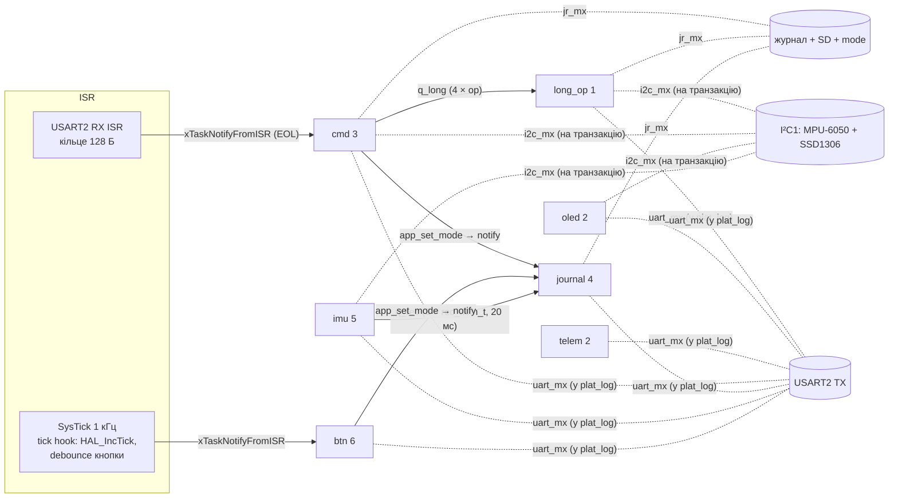

# Дизайн прошивки на FreeRTOS (ЛР4)

Продукт той самий, що в ЛР3: IMU-стабілізатор камери на STM32C031C6 (Cortex-M0+, 48 МГц,
32 КБ Flash, 12 КБ RAM), Wokwi, Форма B. Функціональні вимоги, CLI і формати логів не змінено.
Додано лише нові команди: `tasks`, `trace …`, а в збірці `OSTEST=1` ще `os …`.
Змінилося одне: **хто й коли** викликає кроки логіки. У ЛР3 це робив кооперативний цикл
`app_poll()`, у ЛР4 — сім задач FreeRTOS.

Логіку кроків не переписано: `app_imu_run`, `app_rec_drain`, `app_oled_run` та інші лежать в
`App/app.c` і покриті тими самими host-тестами (105, `make -C tests`). У host-збірці
(`-DAPP_COOP`) вони крутяться в старому циклі над `tests/doubles/fake_os.c`. На цілі їх
викликають задачі з `App/app_rtos.c`. Шар `Interfaces/os.h` відділяє App від FreeRTOS:
`App/` не включає жодного заголовка ядра (`tools/check_deps.py` — 0 порушень).

## 1. Задачі

| Задача | Пріоритет | Чекає на | Період / подія | Що робить | Стек, слів (Б) |
|---|---:|---|---|---|---:|
| `btn` | **6** | сповіщення від tick hook | подія (debounce 30 мс) | реакція на кнопку: LIVE→REC→PLAY | 104 (416) |
| `imu` | **5** | `vTaskDelayUntil` | 5 мс (`rate`), округлено до тіків | I²C-читання MPU-6050, фільтр, CCR серво; раз на 50 мс — потенціометр; раз на 1 с — вікно CPU | 140 (560) |
| `journal` | **4** | REC: `xQueueReceive(q_rec)`; PLAY: `vTaskDelayUntil` | 20 мс | REC: споживач черги → кодер → блок 512 Б на SD; PLAY: відтворення | 112 (448) |
| `cmd` | **3** | сповіщення від USART RX ISR (кінець рядка), таймаут 100 мс | подія | розбір рядка CLI, відповідь | 220 (880) |
| `telem` | 2 | `vTaskDelayUntil` | `telem <ms>` (100 мс) | рядок CSV телеметрії | 120 (480) |
| `oled` | 2 | `vTaskDelayUntil` | 200 мс (режими 1/2 — частинами) | кадр SSD1306 | 168 (672) |
| `long_op` | 1 | `xQueueReceive(q_long)` | подія | `dump`, `calib`; `load N` — штучне навантаження | 156 (624) |
| idle | 0 | — | — | облік часу простою (run-time stats) | 64 (256) |

### 1.1 Чому саме такі пріоритети

Ми призначали пріоритети за **жорсткістю дедлайну**, а не за «важливістю» (rate-monotonic
з поправкою на людину):

1. **`btn` вище за `imu`.** Реакція коротка (≈ 0.2 мс, лише зміна режиму). Тому вона не з'їдає
   період IMU, хоча може трохи зсунути його в межах тіку. Користувач помічає затримку понад
   100 мс, а в ЛР3 вона доходила до 933 мс (H3). Якби `btn` стояла нижче за `imu`, реакцію
   могли б затримати 5 мс-цикли IMU (у режимі REC — разом із чергою).
2. **`imu` — найжорсткіший період** (5 мс, FR-01: стабілізація). Задача коротка: I²C-транзакція
   ≈ 0.6 мс плюс обчислення.
3. **`journal` вище за `cmd`.** Інтервал запису ≤ 25 мс (FR-07) — вимога продукту, а відповідь
   CLI — сервісна. Блок SD пишеться ≈ 4.5 мс, тому черга `q_rec` на 8 записів (160 мс)
   поглинає і запис блоку, і витіснення від `imu`/`btn`.
4. **`cmd` вище за періодичний вивід.** Команда — подія від людини, і її відповідь не повинна
   чекати кадру OLED (63 мс у режимі 0).
5. **`telem` = `oled` = 2** з часовим квантуванням (`configUSE_TIME_SLICING`). Обидві задачі
   «м'які». Кадр OLED довгий, тож за рівного пріоритету телеметрія вклинюється між
   транзакціями I²C кадру, а не чекає його кінця.
6. **`long_op` = 1 — найнижчий пріоритет.** `dump` і `calib` тривають сотні мілісекунд.
   Саме вони в ЛР3 блокували цикл (H4: 436 пропущених періодів IMU). Тепер їх витісняє все
   інше, і вони йдуть лише в простої.

## 2. Взаємодія задач (IPC) і спільні ресурси

| Об'єкт | Тип | Хто пише → хто читає | Навіщо саме такий |
|---|---|---|---|
| сповіщення `btn` | task notification | tick hook → `btn` | найдешевший механізм ISR→задача (без об'єкта в heap); debounce лишився в тіку, як у ЛР3 |
| сповіщення `cmd` | task notification | USART RX ISR → `cmd` | будити лише на кінець рядка, а не на кожен байт |
| `q_rec` | черга 8 × 8 Б | `imu` → `journal` | розв'язує 5-мс IMU і повільний запис SD; 8 записів = 160 мс запасу проти 4.5 мс запису блоку |
| `q_long` | черга 4 × `int` | `cmd` → `long_op` | довга операція не блокує CLI; переповнення → `ERR busy` |
| `i2c_mx` | м'ютекс (успадкування пріоритету), **без тайм-ауту** (П-27) | `imu`, `oled`, `cmd` (selftest, `fault`), `long_op` (`calib`) | одна шина на два пристрої; береться **на одну транзакцію** (≤ 33 Б, ≈ 3.5 мс), тому `imu` чекає щонайбільше одну транзакцію OLED, а не кадр. Час очікування `imu` — `STAT name=bus_wait` |
| `jr_mx` | м'ютекс | `journal`, `cmd` (`mode`, `dump`, `status`), `long_op`, `btn` | журнал, буфер блоку, SD і поле `mode` змінюються разом |
| `uart_mx` | м'ютекс | усі, через `plat_log` | рядок логу не розривається іншою задачею. До старту планувальника та у хуках — `plat_log_raw` без блокування |

**Чому м'ютекси, а не бінарні семафори.** Сценарій 7.2.1 (§5.1) показує інверсію пріоритетів:
`imu` (5) чекає `i2c_mx`, який тримає `oled` (2), а `cmd` (3) витісняє `oled`. Успадкування
пріоритету в м'ютексі FreeRTOS обмежує очікування `imu` однією транзакцією.

**Чому немає черги на кожен рядок телеметрії/логу.** Вивід синхронний під `uart_mx`
(≈ 87 мкс/байт на 115200). Окрема черга виводу коштувала б ще ≈ 1 КБ RAM, якої вже немає
(92.8 % зайнято). Обмеження — §6.

### 2.1 Переривання

| Переривання | NVIC | Що робить у ЛР4 | API ядра |
|---|---:|---|---|
| SysTick | 3 (найнижчий, `configKERNEL_INTERRUPT_PRIORITY = 0xC0`) | `xPortSysTickHandler` → tick hook: `HAL_IncTick` (крок `uwTickFreq = 1000/TICK_HZ`), debounce кнопки; облік вартості тіку | `vTaskNotifyGiveFromISR` |
| PendSV | 3 | перемикання контексту (порт) | — |
| SVC | — | старт першої задачі (порт) | — |
| USART2 RX | 2 | байт → кільце; на `\r`/`\n` — будить `cmd` | `vTaskNotifyGiveFromISR` |
| EXTI4_15 (кнопка) | 3 | мітка тактів першого фронту (вимір затримки) | — |

На ARMv6-M немає `BASEPRI`: критична секція FreeRTOS вимикає **всі** переривання (`cpsid i`).
Тому `*FromISR` можна кликати з будь-якого пріоритету, але кожна критична секція ядра додає
затримку й до RX-переривання. Наскільки — показує `OSTICK max_ns` і `RX dropped` у порівнянні.

## 3. Конфігурація ядра

FreeRTOS-Kernel **V11.1.0**, порт `GCC/ARM_CM0`, `heap_4`
(`firmware/Middlewares/FreeRTOS/VERSION.md`, MIT — `LICENSE.md`).

| Параметр | Значення | Обґрунтування |
|---|---|---|
| `configTICK_RATE_HZ` | **1000** (варіант збірки `TICK_HZ=100`) | період IMU 5 мс має бути кратним тіку; при 100 Гц `vTaskDelayUntil` округлює його до 10 мс (сценарій 7.2.6) |
| `configUSE_PREEMPTION` / `TIME_SLICING` | 1 / 1 | витіснення — головна мета ЛР4; квантування — для `telem`/`oled` |
| `configMAX_PRIORITIES` | 7 | 0…6, кожен рівень використано; більше — зайва RAM на списки готовності |
| `configUSE_PORT_OPTIMISED_TASK_SELECTION` | 0 | на M0+ немає `CLZ` |
| `configMINIMAL_STACK_SIZE` | 64 слова | лише для idle (хуку idle немає) |
| `configTOTAL_HEAP_SIZE` | **5888 Б** (`OSTEST=1`: 6912) | 7 стеків (3 952 Б) + 8 TCB + 2 черги + 3 м'ютекси + стек idle (256 Б) ≈ 5 470 Б; решта — запас (`HEAP min_ever_free`) |
| алокатор | `heap_4` | об'єднує вільні блоки; потрібен для `vTaskDelete` у тестах ОС (7.2.1–7.2.5) |
| `configCHECK_FOR_STACK_OVERFLOW` | **2** (варіант `STACK_CHECK=0`) | перевірка шаблону в кінці стека при кожному перемиканні; хук друкує `FATAL stack overflow task=…` і зупиняє систему |
| `configUSE_MALLOC_FAILED_HOOK` | 1 | `HOOK malloc_failed free=…`, лічильник `HEAP malloc_fail=` |
| `configUSE_TICK_HOOK` | 1 | часова база HAL і debounce кнопки (раніше — у `SysTick_Handler`) |
| `configGENERATE_RUN_TIME_STATS` | 1, лічильник `plat_us()` | CPU за задачами (`tasks`); лічильник — такти 48 МГц / 48, вже був у ЛР3 |
| `configUSE_TRACE_FACILITY` | 0 | `uxTaskGetSystemState` не влазив у Flash; `tasks` обходить власний реєстр задач |
| `configUSE_TIMERS` | 0 | програмні таймери не потрібні; без daemon-задачі економиться ≈ 1 КБ |
| `configUSE_MUTEXES` | 1 | `i2c_mx`, `jr_mx`, `uart_mx` |
| `configASSERT` | → `os_assert_failed` | `FATAL assert file:line` |
| `traceTASK_SWITCHED_IN` | → `os_trace_switched_in()` | кільце 48 перемикань (`trace dump`) або службові піни (`trace pins`) |

Збірка: `-Os -flto`. Без LTO прошивка не влазить у 32 КБ (журнал П-23). `port.c`/`portasm.c`
компілюються без LTO: літеральні пули асемблерних вставок ламаються (П-24).

## 4. Розмір стеків

Початковий розмір — **статична оцінка** (див. також журнал П-25: оцінка виявилась занадто
оптимістичною для `telem`): `-fcallgraph-info=su` дає кадр кожної функції й граф
викликів, `tools/stack_tree.py` шукає найглибший ланцюжок від тіла задачі. Непрямі виклики
(`bus_i2c_t`, `hal_*_ops`) зіставляються вручну. До оцінки додано 64 Б кадру перемикання
контексту і ≈ 15 % запасу.

| Задача | Найглибший ланцюжок | Статично, Б | Виділено, Б |
|---|---|---:|---:|
| `btn` | `app_btn_run → app_set_mode → rec_stop → journal_flush → sd_write_block → spi` | 360 | 416 |
| `imu` | `app_imu_run → mpu6050_read → lk_read → i2c_mem_read → plat_log (помилка)` | 432 | 560 |
| `journal` | `app_rec_drain → rec_add → enc → sd_write_block` | 320 (виміряно 292) | 448 |
| `cmd` | `app_handle_line → selftest → imu_measure → lk_* → I²C` | 768 | 880 |
| `telem` | `app_telem_run → plat_log → os_uart_lock → xQueueSemaphoreTake` | 304 (виміряно 308) | 480 |
| `oled` | `app_oled_run → ssd1306_render → font → lk_write` | 528 | 672 |
| `long_op` | `cmd_dump → sd_read_to → plat_log` | 488 (виміряно 436) | 624 |

**Фінальна перевірка — high water mark** (`tasks`: `stack_free_min`) після найгіршого сценарію
S3 і сценарію `lr4_s3_os`. Виміряні значення і висновок — `docs/comparison.md` §3.

## 5. Сценарії, специфічні для ОС (методичка §7.2)

Збірка `OSTEST=1` (`make OSTEST=1 BUILD_DIR=build-ostest`) додає команди `os …`
(`App/app_rtos.c`, `#ifdef LR4_OSTEST`). Сценарій — `tests/sim/lr4_os.yaml`, результати —
`docs/comparison.md` §4.

| § | Команда | Що відбувається |
|---|---|---|
| 7.2.1 | `os inv mutex` / `os inv sem` | L(1) бере ресурс і тримає 50 мс; M(4) крутиться 300 мс; H(5) просить ресурс. Друкується `INV h_wait_us=`: з м'ютексом ≈ 50 мс (L успадкував 5), з бінарним семафором ≈ 350 мс (L витіснений M) |
| 7.2.2 | `os overflow` | задача на 64 слова рекурсивно з'їдає ≈ 400 Б → `FATAL stack overflow task=ovf`; у збірці `STACK_CHECK=0` — тиха порча сусідньої пам'яті (`tests/sim/lr4_nocheck.yaml`) |
| 7.2.3 | `os starve <ms>` | задача з пріоритетом 6 крутиться без блокування; `imu`, `cmd`, `telem` голодують — видно в `stats` (missed) і `tasks` (CPU) |
| 7.2.4 | `os qflood <n>` | виробник 1/мс, споживач 10 мс/елемент, черга на 8: неблокувальний `send` → втрати; блокувальний з таймаутом → виробник гальмується до темпу споживача |
| 7.2.5 | `os heap` | блоки по 128 Б до відмови: `HOOK malloc_failed`, `HEAPX blocks=`; потім спроба створити чергу → `FAIL`; пам'ять повертається. Збірка `HEAP_BYTES=3000` не створює задач продукту взагалі (`tests/sim/lr4_heapsmall.yaml`) |
| 7.2.6 | — | `tests/sim/lr3_s3_worst.yaml` на збірці `TICK_HZ=100` |
| — | `os ctxsw` | 200 сповіщень задачі з пріоритетом 6 → `CTXSW_COST avg_cyc=` (вартість «сповіщення + перемикання + повернення») |

## 6. Відомі обмеження

- **RAM 92.8 %.** Вільно ≈ 0.9 КБ і ще запас heap. Нова задача — лише за рахунок запасу стеків
  (high water mark).
- **Синхронний вивід UART під м'ютексом.** Задача, що друкує довгий рядок, тримає `uart_mx`
  мілісекунди. Задача вищого пріоритету, яка хоче друкувати, чекає (з успадкуванням).
  `imu` у штатному режимі не друкує.
- **Критичні секції ядра вимикають усі переривання** (M0+). RX на 115200 витримує ≈ 87 мкс
  без втрати байта — найдовша секція має бути коротшою (`OSTICK max_ns`).
- **Період IMU квантується тіком:** `rate 300` дає 3 мс (333 Гц), а не 3.33 мс. Команда
  друкує фактичний `RATE period_us=`.
